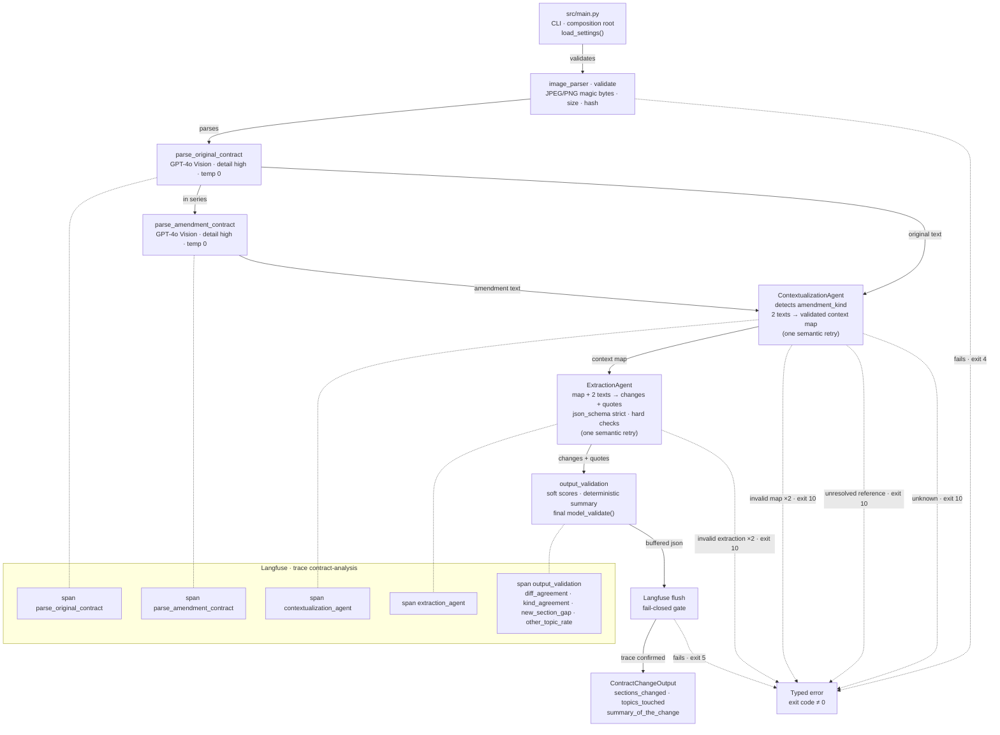
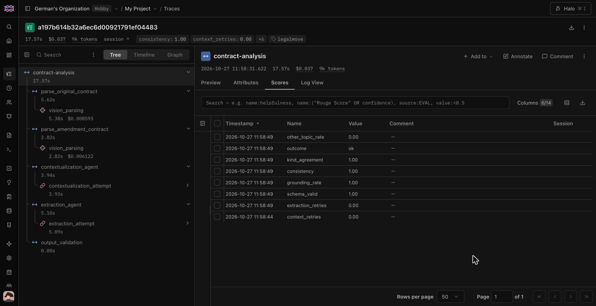

# LegalMove

A command-line tool that reads two scanned images, an original contract and its amendment, and returns a validated JSON describing the legal changes the amendment introduces. Every API call and every agent action is traced in Langfuse.

```bash
uv run python src/main.py data/test_contracts/pair_b/original.png data/test_contracts/pair_b/amendment.png
```

The design lives in [`plan.md`](plan.md) (Spanish) and the assignment in [`requirements.md`](requirements.md). The domain vocabulary is in [`CONTEXT.md`](CONTEXT.md).

## What it is

LegalMove's Compliance team spends more than 40 hours a week comparing original contracts with their amendments by hand: finding what changed, judging its legal impact and routing the documents for review. The work is slow, error-prone and does not scale.

LegalMove automates the comparison:

1. **Vision parsing.** GPT-4o reads each image and returns a verbatim transcription. Unreadable fragments become `[ILLEGIBLE]` marks.
2. **ContextualizationAgent.** Reads both texts, decides the **amendment kind** (`restated`, `delta` or `unknown`) and builds a **context map**: which sections exist, how they correspond and what each one is for. It never extracts changes.
3. **ExtractionAgent.** Reads the context map and both texts and reports each change (addition, removal or modification) with literal quotes as evidence.
4. **Validation.** Deterministic checks (grounding of every quote, consistency, canonical order) gate the result; `ContractChangeOutput.model_validate()` produces the public JSON.

The system fails closed. When it cannot answer with confidence (an `unknown` amendment, a `delta` instruction that rewrites or removes a section the original contract does not have (`UnresolvedReferenceError`), or an agent output that is still invalid after one corrective retry) it exits with code `10`, which means "send to human review". A successful JSON is printed only after the Langfuse trace is flushed.

## Diagram

The animated version, a terminal-style replay of one run, is [`docs/diagrams/legalmove-pipeline.html`](docs/diagrams/legalmove-pipeline.html). Open it in a browser; it has no external scripts. It loads the JetBrains Mono stylesheet from Google Fonts and falls back to the system monospace font offline.



Cross-cutting concerns: personal data is masked before anything reaches Langfuse and images never leave the process except to OpenAI; each call has a 60 s timeout and two transport retries inside a 300 s run budget; `run_id` is always reported and `trace_id` once Langfuse is up.

## Architecture

Lightweight **Ports & Adapters** (hexagonal) on the flat `src/` layout the assignment requires. Dependencies only point inward (domain ← application ← adapters ← `main.py`), and AST-based tests in `tests/test_layering.py` enforce it.

| Layer | Module | Responsibility |
|---|---|---|
| Domain | `src/models.py` | `ContractChangeOutput`, the LLM-facing models (`ContextMap`, `Change`, `ExtractionResult`), enums and the deterministic summary |
| Domain | `src/checks.py` | Deterministic checks: context map semantics, grounding, consistency, `difflib` segment agreement, Kind Heuristic, `[ILLEGIBLE]` count |
| Domain | `src/errors.py` | `LegalMoveError` hierarchy; each error declares its stage and exit code |
| Domain | `src/prompt_blocks.py` | Safe serialization of every dynamic prompt block (prompt-injection defence) |
| Domain | `src/budget.py` | Monotonic run budget; per-attempt timeout and transport retries |
| Application | `src/pipeline.py` | `run_analysis()`: runs the stages in order through the ports, records scores; knows nothing about Langfuse or settings |
| Port | `PipelineTracer`, `StageSpan` (in `src/observability.py`) | What business code may do with a trace: open a stage, set output/metadata/error, record a score |
| Adapter | `src/observability.py` | `LangfuseTracer`: root span, `CallbackHandler`, mask hook, `auth_check()` and `flush()` |
| Adapter | `src/image_parser.py` | `parse_contract_image()`: image validation, base64, GPT-4o vision call, parse cache |
| Adapter | `src/budgeted_model.py` | Builds each attempt's chat model with the timeout and retries the budget still allows |
| Adapter | `src/agents/contextualization_agent.py` | `ContextualizationAgent`: system prompt, structured output, semantic retry |
| Adapter | `src/agents/extraction_agent.py` | `ExtractionAgent`: system prompt, structured output, hard checks, semantic retry |
| Adapter | `src/agents/structured_output.py` | Shared `with_structured_output(..., strict=True, include_raw=True)` plumbing |
| Composition root | `src/main.py` | The only module that loads settings, wires adapters to ports, owns the trace lifecycle and turns errors into exit codes |
| Configuration | `src/config.py` | `Settings` (pydantic-settings, `SecretStr`) and `APP_VERSION` |

The observability port keeps Langfuse out of the business code: agents, the parser and the pipeline receive a `PipelineTracer`; tests swap it for a `RecordingTracer`, so unit tests run with no network and no `.env`.

## Setup

Requirements: **Python 3.14**, [uv](https://docs.astral.sh/uv/), an OpenAI API key with GPT-4o access, and a Langfuse project (public and secret key).

```bash
git clone https://github.com/GDC94/M4-LegalMove.git
cd M4-LegalMove
uv sync                      # runtime + dev group (pytest, ruff, mypy, playwright, jiwer)
cp .env.example .env         # then fill in the three keys
```

Without uv, `requirements.txt` holds the pinned runtime dependencies only (no browser, no test tools):

```bash
python3.14 -m venv .venv && source .venv/bin/activate
pip install -r requirements.txt
python src/main.py data/test_contracts/pair_a/original.png data/test_contracts/pair_a/amendment.png
```

The `dev` group (Playwright and jiwer) is only needed for the golden set and the evals of phase 2. Run every command from the repository root: `.env` and the parse cache are resolved relative to it.

Image resolution: OpenAI scales every image to fit 2048×2048 px, so scanning above that does not improve the reading. Only JPEG and PNG are accepted.

## Configuration

`Settings` in `src/config.py` reads the environment and `.env` (via python-dotenv). Secrets are `SecretStr` and are never logged. `.env.example` is the template; `.env` is git-ignored.

| Variable | Required | Default | Validation | Purpose |
|---|---|---|---|---|
| `OPENAI_API_KEY` | yes | — | `SecretStr` | OpenAI API |
| `LANGFUSE_PUBLIC_KEY` | yes | — | `SecretStr` | Tracing |
| `LANGFUSE_SECRET_KEY` | yes | — | `SecretStr` | Tracing |
| `LANGFUSE_HOST` | no | `https://cloud.langfuse.com` | http(s) URL; `production` rejects `cloud.langfuse.com` and its subdomains | Langfuse instance |
| `APP_ENV` | no | `development` | `development` \| `staging` \| `production` | Trace `environment` |
| `VISION_MODEL` | no | `gpt-4o` | not empty | Image parsing |
| `CONTEXTUALIZATION_MODEL` | no | `gpt-4o` | not empty | ContextualizationAgent |
| `EXTRACTION_MODEL` | no | `gpt-4o` | not empty | ExtractionAgent |
| `LLM_TEMPERATURE` | no | `0.0` | 0–2 | Every call |
| `VISION_DETAIL` | no | `high` | `low` \| `high` \| `auto` | Vision call |
| `LLM_TIMEOUT_SECONDS` | no | `60` | ≥ 1 | Timeout per call |
| `LLM_MAX_RETRIES` | no | `2` | 0–10 | Transport retries per logical call |
| `PIPELINE_TIMEOUT_SECONDS` | no | `300` | ≥ `LLM_TIMEOUT_SECONDS` | Total run budget |
| `MAX_IMAGE_BYTES` | no | `10000000` | ≥ 1 | Own cost limit (OpenAI sets no byte limit per image) |
| `MIN_IMAGE_SIDE_PX` | no | `600` | ≥ 1 | Own legibility limit |
| `MAX_IMAGE_SIDE_PX` | no | `4096` | ≥ `MIN_IMAGE_SIDE_PX` | Decoding and memory limit |
| `MAX_IMAGE_PIXELS` | no | `16777216` | ≥ 1 | Guard against decompression bombs |
| `ILLEGIBLE_MAX_MARKS` | no | `10` | ≥ 0 | `[ILLEGIBLE]` marks allowed per page before `IllegibleDocumentError` |
| `PARSE_CACHE_DIR` | no | `.cache/parsed` | path | Local parse cache (git-ignored) |
| `PARSE_CACHE_ENABLED` | no | by `APP_ENV` | optional bool | Unset: on in `development`, off elsewhere; `production` needs an explicit opt-in |
| `PARSE_CACHE_TTL_HOURS` | no | `24` | ≥ 1 | Lazy expiry of cached transcriptions |
| `LOG_LEVEL` | no | `INFO` | `DEBUG` \| `INFO` \| `WARNING` \| `ERROR` \| `CRITICAL` | Logs to stderr |
| `JUDGE_MODEL` | no | `gpt-4.1` | not empty; differs from `EXTRACTION_MODEL` | Evals only (`EvalSettings` in `evals/settings.py`): the Judge of `summary_of_the_change` |

Deliberately not configurable: personal-data masking (always on), the semantic retries (exactly one per agent) and model fallback (none in this delivery). The public `cloud.langfuse.com` host is for synthetic data only.

## Usage

```bash
uv run python src/main.py <original.png> <amendment.png> [--session-id <id>]
```

- `original`, `amendment`: paths to the scanned original contract and the amendment (JPEG or PNG).
- `--session-id`: optional Langfuse session that groups several runs, for example a batch.

Run it on the two committed pairs:

```bash
uv run python src/main.py data/test_contracts/pair_a/original.png data/test_contracts/pair_a/amendment.png
uv run python src/main.py data/test_contracts/pair_b/original.png data/test_contracts/pair_b/amendment.png
```

stdout carries only the JSON, so it can be piped. For pair B (a `delta` amendment) the sections and topics are fixed; the summary wording comes from the model's change descriptions and varies between runs:

```json
{
  "sections_changed": [
    "2",
    "5"
  ],
  "topics_touched": [
    "term_duration",
    "penalties"
  ],
  "summary_of_the_change": "2 — modified: El plazo de vigencia pasa de doce (12) a veinticuatro (24) meses. 5 — removed: Se deja sin efecto la cláusula de penalidades a partir del 1 de octubre de 2026."
}
```

Pair A (a `restated` amendment) reports `["3", "new:8"]` and `["price_payment", "confidentiality"]`.

stderr carries the logs and a final JSON line. On success it is `{"run_id": "...", "trace_id": "..."}`. On failure stdout stays empty and the last line is the error envelope `{"error", "stage", "message", "run_id", "trace_id"}`, plus `issues` for exit code `10`. Neither messages nor logs ever contain document text.

| Error | Stage | When | Exit code |
|---|---|---|---|
| (success) | — | The trace was flushed before stdout was written | `0` |
| unexpected error (`UnexpectedError` in the envelope) | `unknown` | A bug nobody anticipated | `1` |
| `UsageError` | `cli` | Invalid arguments | `2` |
| `ConfigurationError` | `composition` | Missing keys or out-of-range settings | `3` |
| `InvalidImageError` | `validation` | Missing file, not JPEG/PNG, or bytes, sides, pixels or decoding out of limits | `4` |
| `UpstreamError` | `parse`, `contextualization` or `extraction` | The model API still fails after the transport retries, or times out | `5` |
| `ObservabilityError` | `observability` | Langfuse rejects the keys at start-up, or the flush raises | `5` |
| `IllegibleDocumentError` | `parse` | More `[ILLEGIBLE]` marks than `ILLEGIBLE_MAX_MARKS`, or the vision model returned empty text | `6` |
| `UnclassifiableAmendmentError` | `contextualization` | `amendment_kind = unknown`; never retried | `10` |
| `UnresolvedReferenceError` | `contextualization` | A `delta` instruction rewrites or removes a Section the original contract does not have (`issues` code `unresolved_reference`); never retried | `10` |
| `InvalidContextMapError` | `contextualization` | The context map is still invalid after its semantic retry | `10` |
| `InvalidExtractionError` | `extraction` | The extraction is still invalid after its semantic retry | `10` |

Exit code `10` always means the same thing to the calling system: route the case to human review. The concrete reason travels as `issues` (`code`, `path`, `message`).

## Tracing

Each run is one Langfuse trace. The root span and the four stage spans follow the structure the assignment suggests; `output_validation` is added for the final checks.

```text
contract-analysis                       root span
├── parse_original_contract             span
│   └── vision_parsing                  ChatOpenAI generation: tokens, cost, latency
├── parse_amendment_contract            span
│   └── vision_parsing                  ChatOpenAI generation
├── contextualization_agent             span
│   ├── contextualization_attempt       chain → ChatOpenAI generation
│   └── contextualization_retry         chain → ChatOpenAI generation (only after an invalid map)
├── extraction_agent                    span
│   ├── extraction_attempt              chain → ChatOpenAI generation
│   └── extraction_retry                chain → ChatOpenAI generation (only after an invalid extraction)
└── output_validation                   span: soft scores + final model_validate()
```

The root propagates `session_id` (from `--session-id`), `environment` (`APP_ENV`), `version` (`APP_VERSION`) and the `legalmove` tag. Its metadata holds `run_id`, `amendment_kind`, the prompt versions and the models.

| Span | Input | Output | Metadata |
|---|---|---|---|
| `contract-analysis` | File names (never the images) | `ContractChangeOutput` or the error envelope | `run_id`, `amendment_kind`, image hashes, prompt versions, models |
| `parse_*_contract` | `image_sha256`, bytes, dimensions | Masked parsed text | `cache_hit`, `illegible_count`, prompt version and hash |
| `contextualization_agent` | Length of each text | Masked context map | `amendment_kind`, `kind_heuristic`, `context_retries`, prompt version |
| `extraction_agent` | Section IDs of the map | Masked extraction result | `extraction_retries`, masked retry feedback, `schema_valid`, `consistency`, `grounding_rate` |
| `output_validation` | — | Final `model_validate()` result | `diff_agreement` with its coverage, `kind_agreement`, `new_section_gap`, `other_topic_rate` |

| Score | Values | Source |
|---|---|---|
| `outcome` | `ok` \| `human_review` \| `failed` | Result of the run |
| `schema_valid` | 0/1 | Hard schema check inside `extraction_agent` |
| `consistency` | 1 \| 0 \| N/A | Consistency check inside `extraction_agent`; N/A when the schema failed without an inconsistency error |
| `grounding_rate` | 0–1, N/A without changes | Quotes found / total quotes |
| `diff_agreement` | 0–1, `restated` only | Jaccard over the sections `difflib` can segment |
| `kind_agreement` | 0/1, N/A when the heuristic is inconclusive | Kind Heuristic against the ContextualizationAgent |
| `new_section_gap` | 0/1, `delta` only; N/A without numbered `new:` and original Sections | 1 when the numbered `new:` Sections do not continue the original numbering without gaps |
| `other_topic_rate` | 0–1, N/A without changes | Share of `Topic.other` |
| `context_retries`, `extraction_retries` | 0 \| 1 | Semantic retries spent |

A score with no denominator is not recorded: N/A is never turned into 0 or 1.

**Privacy.** The `mask` hook of the Langfuse client redacts identifiers (DNI/CUIT/CUIL, CBU/IBAN, emails, phone numbers) in every observation, including LangChain generations. Amounts are kept on purpose. Images are replaced by their hash and dimensions, and Langfuse media upload is disabled. Proper names cannot be masked reliably by pattern (see Known limitations).

**Lifecycle.** `main.py` creates one client per process, checks the keys with `auth_check()` before spending on OpenAI, and calls `flush()` before writing stdout. If the flush raises, stdout stays empty and the run ends with `ObservabilityError` (exit `5`). The SDK logs OTLP export errors without raising them, so delivery after a successful flush is best-effort.

A real trace of pair B in Langfuse:



## Testing and evals

Three levels, each answering a different question:

| Level | Question | Command | Network / keys |
|---|---|---|---|
| Unit + architecture | Does the code do what it says? | `uv run pytest` | No |
| Integration | Does it work against the real APIs? | `uv run pytest -m integration` | Yes (OpenAI and Langfuse) |
| Evals | Is the system good at analysing contracts? | `PYTHONPATH=src uv run python evals/run_evals.py --split calibration` | Yes (OpenAI and Langfuse) |

```bash
uv run pytest                                                       # unit + architecture, no .env needed
uv run ruff check . && uv run ruff format --check . && uv run mypy src   # style gate
uv run pytest -m integration                                        # spends OpenAI and Langfuse credit
PYTHONPATH=src uv run python evals/run_evals.py --split calibration  # spends credit; src must be on the path
```

- **Unit tests** replace adapters with recording doubles (`RecordingTracer`, scripted structured models) and run offline.
- **Architecture tests** (`tests/test_layering.py`, `tests/test_llm_schema.py`, `tests/test_requirements.py`, `tests/test_readme.py`, `tests/test_gitignore.py`, `tests/test_ci_workflow.py`) check the dependency direction, the strict JSON-schema subset, the `==` pins, the deliverables, this README and `.env.example`, the git-ignored secrets and caches, and the CI workflow.
- **Integration tests** run real vision and both agents on the two pairs, read the trace back through the Langfuse API, and prove that masking and the fail-closed flush work end to end. They are skipped when the keys are missing.
- **Evals** run every reviewed case of a Split through the same composition root as the CLI, grade it with pure checks (`evals/metrics.py`: CER, `amendment_kind` accuracy, micro precision and recall of `sections_changed`, `change_type` accuracy, topic Jaccard, Key Fact coverage, the Judge on `JUDGE_MODEL` and the expected exit `10`), write `outputs/eval_report.json` (global, per category, per Amendment Kind and per case, with the evaluable case count of each metric; N/A never counts as 0), compare it with `outputs/baseline.json` when that file exists, and publish the Split as a Langfuse Dataset and the run as an Experiment with the checks as evaluators. In `development` the parse cache is on by default, so a re-run within `PARSE_CACHE_TTL_HOURS` reuses the cached transcriptions: its CER repeats the first run's instead of measuring vision again. Set `PARSE_CACHE_ENABLED=false` (or clear `.cache/parsed`) to re-measure CER.
- **CI** (`.github/workflows/ci.yml`) runs the style gate and the unit tests on every push. It has no secrets and never runs integration tests or evals.

### Measured results

Placeholder: the golden set, the evals and this table of measured results (parsing CER, `sections_changed` precision and recall, `change_type` accuracy, `amendment_kind` accuracy, summary judge score) are filled in T10, once the baseline is frozen.

| Metric | Threshold | Validation result |
|---|---|---|
| — | — | Filled in T10 |

## Technical decisions

A summary of the decision log in `plan.md` §8.4.

| Decision | Why |
|---|---|
| Flat `src/` with lightweight Ports & Adapters | The assignment fixes the paths; dependency direction and ports are what matter, and AST tests enforce them |
| Deterministic LangChain chains, not tool-using agents | The flow is fixed and needs no tools; less injection surface |
| Accept `restated` and `delta` amendments; `unknown` goes to human review | Production does not control the amendment format; a wrong JSON costs more than a referral |
| Structured `ContextMap`, rendered as plain text for the ExtractionAgent | Deterministic checks need structure; the second agent reads text better than JSON |
| `with_structured_output(method="json_schema", strict=True)` with a JSON schema dict, plus `model_validate()` | Strict decoding constrains the model; validation stays ours so a failure can feed the retry |
| LLM-facing models use validators, not `Field` constraints | OpenAI strict mode rejects keywords such as `minLength`, and nothing strips them |
| One semantic retry per agent, with the previous attempt and the validation errors | Bounds cost and fails closed |
| Every quote must be grounded in its parsed text (NFKC, `casefold()`, no fuzzy match) | Tolerates transcription noise without accepting invented quotes |
| The public summary is rendered from the validated changes | Reduces hallucination surface while keeping the three required fields |
| Closed `Topic` taxonomy with a monitored `other` | Output a downstream system can process and evaluate |
| `difflib` agreement and the Kind Heuristic are soft scores; structural presence is a hard check | An uncalibrated OCR threshold must not gate production |
| Exit code `10` means human review | One actionable code for the consumer |
| Langfuse keys are mandatory; masking always on; images never sent; flush before stdout | Traceability is a requirement and the data is sensitive |
| 60 s per call, two transport retries, 300 s per run, rebuilt per attempt from the remaining budget | SDK transport retries reuse the per-call timeout and could exceed the run budget |
| Parse cache keyed by image hash and prompt hash, on by default only in development | Avoids paying vision twice without persisting sensitive text in production |
| Two build phases: the full assignment on two minimal Pillow-rendered pairs first, the golden set later | A working delivery early; the Standard golden cases replace the two pairs later |
| Pinned dependencies (`==`) exported from `uv.lock`; Playwright and jiwer in the `dev` group | Reproducible installs and a `requirements.txt` with no browser |

## Known limitations

- **One page per image.** Multi-page contracts are not supported.
- **Spanish only.**
- **Handwriting and hand annotations** are not guaranteed to be read.
- **Complex tables** are transcribed as text and may lose their structure.
- **One original against one amendment.** Amendment chains (amendment 2 modifying amendment 1) are not supported.
- **No legal-impact scoring** beyond the `Topic` taxonomy.
- **One synchronous run per pair.** No HTTP API, batch processing or async execution.
- **Sequential parsing.** The two images are parsed one after the other.
- **Local cache.** It lives on the filesystem, is not shared between machines and is not encrypted by the application.
- **Proper names are not masked** in Langfuse.
- **Synthetic test data.** Until real amendments are available, quality in production is not measured.

## Deliverables

Each deliverable of the assignment (`requirements.md`) and where it lives.

| ID | Deliverable | Path | Verification |
|---|---|---|---|
| E01 | Main script that takes two image paths and runs the full pipeline | `src/main.py` | arch: file exists; integration: end-to-end run |
| E02 | Agent 1 with its own system prompt and logic | `src/agents/contextualization_agent.py` | arch: file exists; unit: prompt and retry |
| E03 | Agent 2 with its own system prompt and logic | `src/agents/extraction_agent.py` | arch: file exists; unit: prompt, checks and retry |
| E04 | Image utilities: validation, encoding and multimodal calls | `src/image_parser.py` | arch + unit |
| E05 | Pydantic models with `ContractChangeOutput` | `src/models.py` | arch + unit |
| E06 | At least 2 pairs (4 images) with an explanatory README | `data/test_contracts/`, with `data/test_contracts/README.md` | arch: ≥ 4 images and the README exist; manual review |
| E07 | README with diagrams, architecture, setup, usage and technical decisions | `README.md` | arch: `tests/test_readme.py` |
| E08 | `requirements.txt` with pinned versions | `requirements.txt` | arch: every declared dependency pinned with `==` |
| E09 | Environment variable template | `.env.example` | arch: every `Settings` variable appears as `NAME=` or `# NAME=` |
| E10 | Langfuse integration with a span hierarchy | `src/observability.py` | unit + integration |
| E11 | Public GitHub repository | https://github.com/GDC94/M4-LegalMove | manual: public and up to date |

## Vocabulary

The assignment is written in Spanish; the code and `CONTEXT.md` use these names.

| Assignment term | Code name | Notes |
|---|---|---|
| contrato original | Original Contract, `original` | — |
| enmienda, adenda | Amendment, `amendment` | One amendment per run |
| tipo de adenda (texto ordenado / solo instrucciones) | `AmendmentKind`: `restated`, `delta`, `unknown` | `unknown` always goes to human review |
| texto parseado | Parsed Contract, `ParsedContract` | Verbatim text, image hash and `[ILLEGIBLE]` count |
| `parse_contract_image()` | `ContractImageParser.parse_contract_image()` | In `src/image_parser.py` |
| mapa contextual | Context Map, `ContextMap` | One `SectionMapping` per section; never lists changes |
| sección, cláusula | Section; `section_id` | Canonical ID: `5`, `5.2`, `§7`, `new:8` |
| cambio | Change, `Change` | One section, one `ChangeType`, one `Topic`, quotes |
| adición / eliminación / modificación | `ChangeType`: `added`, `removed`, `modified` | Additions and removals are whole sections |
| temas legales afectados | `topics_touched`, `Topic` | Closed taxonomy |
| secciones modificadas | `sections_changed` | Canonical order |
| resumen de los cambios | `summary_of_the_change` (Summary) | Rendered from the validated changes |
| cita textual | Quote | Must be grounded in its parsed text |
| revisión humana | Human Review, `NeedsHumanReviewError` | Exit code `10` |
| span raíz / spans hijos | `contract-analysis` / Stage spans | `PipelineTracer.stage()` |
