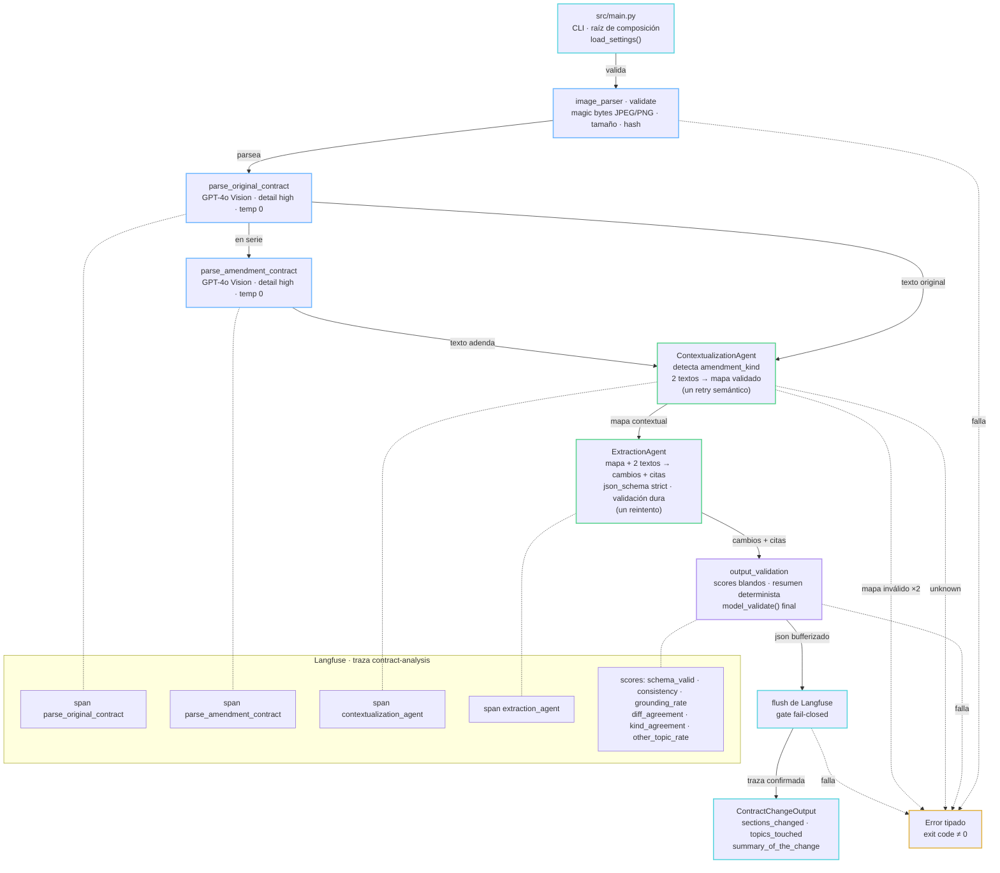

# LegalMove — Plan de implementación

## 1. Qué construimos

Una CLI en Python que recibe dos imágenes escaneadas (contrato original y adenda) y devuelve un JSON validado con los cambios legales introducidos por la adenda.

```bash
uv run python src/main.py <original.png> <amendment.png>
```

### Pipeline

Ejecución lineal y síncrona, con una traza raíz en Langfuse y un span hijo por etapa:

```text
contract-analysis                 traza raíz
├── parse_original_contract       GPT-4o Vision: imagen → texto fiel
├── parse_amendment_contract      misma función, segunda ejecución
├── contextualization_agent       mapa de secciones: correspondencia y propósito (no extrae cambios)
└── extraction_agent              mapa + ambos textos → ExtractionResult
```

### Responsabilidades por etapa

| Etapa | Input | Output | No hace |
|---|---|---|---|
| `parse_contract_image()` | path JPEG/PNG | texto completo del documento | interpretar el contenido |
| `ContextualizationAgent` | texto original + texto adenda | mapa contextual (texto estructurado) | detectar cambios |
| `ExtractionAgent` | mapa + ambos textos | `ExtractionResult` | releer imágenes |

### Contrato de salida

`ContractChangeOutput` (Pydantic) con exactamente los tres campos de la consigna:

| Campo | Tipo | Descripción |
|---|---|---|
| `sections_changed` | `list[str]` | Identificadores de las secciones modificadas |
| `topics_touched` | `list[str]` | Categorías legales/comerciales afectadas |
| `summary_of_the_change` | `str` | Descripción detallada de los cambios |

Las listas públicas se validan contra `changes`. El resumen público no se copia sin control desde el agente: se renderiza de forma determinista a partir de las descripciones de los `Change` ya validados (sección 3.3).

### Layout del repositorio

Estructura plana, tal como exige la consigna (decisión: opción A):

Los archivos marcados con `*` son los entregables obligatorios. Los demás separan responsabilidades sin romper la estructura plana.

```text
src/
├── main.py                *        CLI + raíz de composición (único que llama a load_settings)
├── pipeline.py                     run_analysis(): orquesta las etapas, sin conocer Langfuse
├── image_parser.py        *        validación, base64, llamada multimodal
├── models.py              *        ContractChangeOutput + modelos internos + enums
├── checks.py                       checks deterministas: consistencia, grounding, diff, heurística delta
├── errors.py                       jerarquía LegalMoveError
├── prompt_blocks.py                serialización segura de todos los bloques dinámicos (sección 4.3)
├── config.py                       Settings (pydantic-settings) + constante APP_VERSION
├── observability.py                puerto PipelineTracer + adaptador Langfuse + masking
└── agents/
    ├── contextualization_agent.py *
    └── extraction_agent.py        *
data/test_contracts/       *        ≥ 2 pares (PNG + source_*.txt) + README
data/golden/                        golden set (sección 6.4)
evals/                              render_plain.py, generate_golden.py, run_evals.py, EvalSettings
outputs/                            eval_report.json (ignorado por git), baseline.json (commiteado)
tests/
pyproject.toml                      sin [build-system]; pytest con pythonpath = ["src"]
requirements.txt           *        exportado desde uv.lock
.env.example               *
.gitignore
.github/workflows/ci.yml          CI mínimo desde T4 (sección 6.9)
CLAUDE.md, CONTEXT.md
README.md                  *
```

**Imports y empaquetado.** `src/` es plano y el proyecto no es un paquete instalable: `pyproject.toml` no tiene `[build-system]`. `uv run python src/main.py` pone `src/` en `sys.path`, y todos los imports son absolutos desde esa raíz (`from models import ...`, `from agents.extraction_agent import ...`). Para pytest, `[tool.pytest.ini_options] pythonpath = ["src"]`. `APP_VERSION` es una constante de `config.py` y se usa como `version` de la traza.

### Arquitectura

**Patrón: Ports & Adapters (hexagonal) en versión liviana**, sobre el layout plano. Lo que se adopta del patrón es la dirección de las dependencias, los puertos como `Protocol` y una única raíz de composición; no se adoptan carpetas `domain/application/infrastructure` porque la consigna fija paths planos y el flujo es un único caso de uso lineal de cuatro etapas.

| Capa | Módulos | Regla |
|---|---|---|
| Dominio | `models.py`, `checks.py`, `errors.py`, `prompt_blocks.py` | Pydantic y lógica determinista. No importan LangChain, OpenAI, Langfuse ni `config.py` |
| Aplicación | `pipeline.py` (`run_analysis()`) | Orquesta las etapas a través de los puertos. No conoce Langfuse ni la configuración |
| Puertos | `PipelineTracer` y `StageSpan` (Protocol, sección 5.2); el `chat_model` que recibe cada `build_*` | Los módulos de negocio dependen de la abstracción, nunca del proveedor |
| Adaptadores | `observability.py` (Langfuse), `image_parser.py` y `agents/` (OpenAI vía LangChain) | Únicos módulos que tocan infraestructura externa |
| Raíz de composición | `main.py` | Único que llama a `load_settings()`, construye el contenedor `@dataclass(frozen=True)` y cablea adaptadores con puertos |

Regla de dependencias: dominio ← aplicación ← adaptadores ← `main.py`. Las flechas solo apuntan hacia adentro; un módulo nunca importa a uno de una capa más externa. Los tests de arquitectura por AST (sección 6.2) hacen cumplir estas reglas en CI, de modo que la arquitectura es declarada y verificada, no inferida. `CLAUDE.md` repite esta tabla para que cada ticket se implemente contra ella.

### Fases de construcción

| Fase | Alcance | Imágenes de prueba |
|---|---|---|
| 1 | La consigna completa, de punta a punta (sección 6.8, tickets T0 a T6) | 2 pares renderizados de forma mínima con Pillow (`evals/render_plain.py`): texto negro sobre fondo blanco, sin Playwright y sin degradaciones |
| 2 | Infraestructura de golden (sección 6.4, tickets T7 a T10): generador con Playwright, degradaciones, evals y línea base | Los casos Standard reemplazan después a los 2 pares de la fase 1 |

### Fuera de alcance

- **DSPy.** Se evaluó y se descartó para el runtime. La consigna exige LangChain y los structured outputs `strict` de OpenAI ya restringen la generación. Los optimizadores de DSPy necesitarían un dataset etiquetado mucho más grande.
- API HTTP, procesamiento asíncrono y multi-página.

### Decisión tomada

- **Formato de la adenda: se aceptan todas las variantes (opción C).** El sistema tiene que poder ir a producción, y ahí no se controla en qué formato llegan las adendas. Ver sección 2.

## 2. Formato de los contratos y las adendas

### 2.1 Supuestos sobre el input

| Aspecto | Supuesto | Si no se cumple |
|---|---|---|
| Archivo | Una imagen JPEG o PNG por documento | Error tipado antes de llamar al LLM |
| Páginas | Una página por imagen | Fuera de alcance (ver Riesgos y limitaciones) |
| Idioma | Español | No se garantiza la calidad |
| Estructura | Secciones identificables por número o título | El agente 1 usa identificadores posicionales (`§1`, `§2`, …) |

### 2.2 Tipos de adenda (`AmendmentKind`)

| Valor | Qué es | Ejemplo |
|---|---|---|
| `restated` | El contrato completo, reescrito con los cambios ya aplicados | Una "versión consolidada" de todo el contrato |
| `delta` | Un documento que solo enumera instrucciones de cambio | "La cláusula quinta queda redactada de la siguiente manera…", "Se deja sin efecto la cláusula séptima", "Se incorpora la cláusula décima" |
| `unknown` | No se puede clasificar con confianza | Un documento ilegible o que no es una adenda |

`unknown` no se adivina: el pipeline lo termina con un error tipado que indica que la adenda necesita revisión humana. En producción es preferible derivar el caso a una persona antes que devolver un JSON equivocado.

### 2.3 Detección

- El `ContextualizationAgent` clasifica la adenda como parte de su output estructurado. Primero devuelve el campo de razonamiento y después `amendment_kind`.
- **Segunda señal determinista:** se buscan marcadores típicos de una adenda `delta` ("queda redactada", "se deja sin efecto", "se incorpora", "las partes acuerdan modificar"). La heurística devuelve `delta` o `inconclusive`: la ausencia de marcadores nunca se interpreta como evidencia de `restated`. `kind_agreement` se registra solo cuando la heurística devuelve `delta`; si es inconclusa, el score es N/A. La heurística no bloquea la ejecución.
- `unknown` es una salida válida que deriva directamente a revisión humana. No consume el reintento semántico del mapa: volver a preguntar sobre la misma evidencia no agrega información.

### 2.4 Normalización de identificadores de sección

Los contratos nombran sus secciones de muchas formas. El agente 1 mapea cada una a un ID canónico, y ese ID es el que se usa en `sections_changed`:

| Variante en el documento | ID canónico |
|---|---|
| "Cláusula Quinta", "Cláusula 5ª", "5.", "Artículo V" | `5` |
| "5.2", "Punto 5 inciso 2" | `5.2` |
| Sección original sin numerar, por ejemplo "Confidencialidad" | ID posicional `§7`; el título vive en `title` |
| Sección nueva numerada | `new:` + su número en la adenda, por ejemplo `new:5` o `new:5.2` |
| Sección nueva sin numerar | ID posicional en la adenda, por ejemplo `new:§7`; el título vive en `title` |

**Gramática canónica.** Los IDs numerados usan enteros positivos separados por puntos (`5`, `5.2`); los posicionales usan `§` más un entero positivo (`§7`); los IDs nuevos anteponen `new:` (`new:5`, `new:5.2`, `new:§7`). El título nunca forma parte del ID. Un `field_validator` hace cumplir esta gramática.

**Regla: el `section_id` siempre sigue la numeración del original.** Una sección que solo existe en la adenda recibe el prefijo `new:` y el ID que le corresponde allí. Una sección renumerada con el contenido sin cambios **no** es un `Change`.

**Orden canónico.** `ContextMap.sections` contiene primero las secciones del original en su orden documental y después las secciones `new:` en el orden de la adenda. `sections_changed` es una subsecuencia de ese orden; `topics_touched` sigue el orden de primera aparición en `changes`. `checks.py` valida ambos órdenes como reglas duras.

Ejemplo de renumeración: el original tiene las secciones 1 a 7. La adenda inserta una sección nueva en la posición 5 y renumera las anteriores 5 a 7 como 6 a 8. Resultado: la sección nueva es `new:5`, las secciones 6 a 8 de la adenda se mapean a los `section_id` `5`, `6` y `7` del original, y si su contenido no cambió no generan ningún `Change`.

### 2.5 Comportamiento según el tipo

| | `restated` | `delta` |
|---|---|---|
| Qué hace el agente 1 | Alinea las secciones del original con las de la adenda | Resuelve cada instrucción hacia la sección del original que modifica |
| Qué recibe el agente 2 | Pares de secciones (original ↔ adenda) | Pares (sección original ↔ instrucción) |
| Cómo se ven las adiciones | Secciones que no existen en el original | "Se incorpora…" |
| Cómo se ven las eliminaciones | Secciones del original que no están en la adenda | "Se deja sin efecto…" |
| Diff con `difflib` | Se aplica como segunda señal (segmentación y umbral abajo) | No se aplica (`diff_agreement` = N/A) |
| Grounding con citas | Las citas existen en el original y en la adenda | Las citas existen en la instrucción, y la sección referida existe en el original |
| Riesgo particular | Que una sección renumerada se marque como un cambio falso | Que la referencia ("la quinta") se resuelva a una sección equivocada |

**Segmentación para `difflib` (solo `restated`).** Se localizan los strings `original_ref` y `amendment_ref` de cada `SectionMapping` (después de la misma normalización del grounding, sección 4.4) dentro de cada texto parseado, y cada sección se corta hasta la siguiente referencia en el orden del documento. Si una referencia no se encuentra, esa sección queda fuera del diff y se registra la cobertura `sections_diffed / sections_total`.

**Umbral.** Una sección cuenta como cambiada si `difflib.SequenceMatcher.ratio() < 0.97` sobre el texto normalizado. El umbral es una constante de `checks.py` (no una variable de entorno) y se calibra con el split `calibration`. `diff_agreement` es el Jaccard entre el conjunto de secciones que marca `difflib` y el que marca el agente 2, calculado solo sobre las secciones segmentables.

`difflib` es telemetría blanda en la primera versión: mide desacuerdos, pero no reintenta ni deriva a revisión humana hasta demostrar suficiente precisión en calibración. No se presenta como una mitigación runtime de omisiones. En cambio, la estructura inequívoca del mapa sí es dura: en una adenda `restated`, una fila presente solo del lado de la adenda exige un `added`, y una presente solo del lado original exige un `removed`.

**Granularidad de `ChangeType`.** `added` y `removed` describen secciones completas. Agregar o quitar un párrafo, inciso o frase dentro de una sección existente se clasifica como `modified`, porque la unidad pública de reporte es la sección.

La salida es la misma para los dos tipos: `ContractChangeOutput` no cambia. `amendment_kind` se registra en la metadata de la traza, no en el JSON público.

### 2.6 Impacto en los golden cases

- Cada categoría (Standard, Variant, Boundary) tiene casos `restated` **y** casos `delta`.
- Se agregan casos específicos de cada formato:
  - `delta` que referencia una cláusula inexistente: debe terminar en error o en revisión humana, no inventar una sección.
  - `delta` que reescribe la cláusula con el mismo texto: no hay cambio real.
  - adición o eliminación de un párrafo dentro de una sección: `modified`, no `added`/`removed`.
  - Adenda `unknown`: un documento que no es una adenda.
- Check adicional: la exactitud de `amendment_kind`.

## 3. Modelos de datos y taxonomía

Todos los modelos son `BaseModel` de Pydantic v2 y viven en `src/models.py`, porque los comparten los agentes, los checks y la CLI. Los enums son `StrEnum`. En los outputs del LLM, el campo de razonamiento va primero, antes que los campos de decisión. Los modelos que ve el LLM (`ContextMap`, `SectionMapping`, `Change`, `ExtractionResult`) nunca usan restricciones de `Field` que lleguen al JSON schema (`min_length`, etc.): toda regla es un `field_validator` o un `model_validator` (sección 6.1).

### 3.1 Flujo de modelos

```text
imagen ──► ParsedContract ×2 ──► ContextMap ──► ExtractionResult ──► ContractChangeOutput
          parser secuencial      agente 1        agente 2            listas validadas +
                                                                      resumen renderizado +
                                                                      model_validate()
```

`ExtractionResult` **no** hereda de `ContractChangeOutput`: es un modelo propio que repite los tres campos con el mismo nombre, tipo y descripción (un test de arquitectura lo verifica, sección 6.2).

### 3.2 Enums

| Enum | Valores | Uso |
|---|---|---|
| `DocumentRole` | `original`, `amendment` | Identifica cada `ParsedContract` |
| `AmendmentKind` | `restated`, `delta`, `unknown` | Formato de la adenda (sección 2.2) |
| `ChangeType` | `added`, `removed`, `modified` | Tipo de cada cambio |
| `Topic` | ver 3.4 | Categoría legal o comercial de cada cambio |

### 3.3 Modelos

**`ParsedContract`**: el output de `parse_contract_image()`. La visión devuelve texto plano y el resto de los campos se calcula sin LLM.

| Campo | Tipo | Notas |
|---|---|---|
| `role` | `DocumentRole` | |
| `source_path` | `str` | |
| `image_sha256` | `str` | Clave del caché y metadata de la traza |
| `text` | `str` | No vacío |
| `illegible_count` | `int` | Cantidad de marcas `[ILLEGIBLE]`, calculada en forma determinista |

**`SectionMapping`**: una fila del mapa contextual. Describe la correspondencia entre secciones, **no** los cambios.

| Campo | Tipo | Notas |
|---|---|---|
| `section_id` | `str` | ID canónico (sección 2.4) |
| `title` | `str \| None` | |
| `original_ref` | `str \| None` | Cómo aparece en el original. `None` si la sección no existe ahí |
| `amendment_ref` | `str \| None` | Cómo aparece en la adenda, o la instrucción que la referencia |
| `purpose` | `str` | Propósito del bloque |

**`ContextMap`**: el output estructurado del agente 1.

| Campo | Tipo | Notas |
|---|---|---|
| `reasoning` | `str` | Primero |
| `amendment_kind` | `AmendmentKind` | |
| `sections` | `list[SectionMapping]` | Sin `section_id` duplicados; orden canónico de la sección 2.4 |

La consigna permite que el agente 1 devuelva texto libre. Elegimos un modelo estructurado porque los checks deterministas necesitan `amendment_kind` y los `section_id`. Para el prompt del agente 2, el mapa se convierte a texto legible.

Antes de usar el mapa, `checks.py` valida como reglas duras que los IDs cumplan la gramática y el orden canónico, que no haya una fila con ambos refs en `None` y que cada ref no nulo exista en el texto correspondiente después de la normalización de grounding. Si falla, el agente 1 recibe un único reintento semántico; una segunda falla produce `InvalidContextMapError` y revisión humana. `amendment_kind=unknown` no es una falla de validación y no se reintenta.

**Render del mapa para el agente 2.** Texto plano dentro de `<context_map>`, sin JSON: una primera línea `amendment_kind: …` y después una línea por sección, por ejemplo:

```text
<context_map>
amendment_kind: restated
[5] Precio | original: "Cláusula Quinta" | amendment: "Cláusula Quinta" | purpose: …
</context_map>
```

**`Change`**: un cambio con su evidencia.

| Campo | Tipo | Notas |
|---|---|---|
| `section_id` | `str` | Tiene que existir en el `ContextMap` |
| `change_type` | `ChangeType` | |
| `topic` | `Topic` | |
| `description` | `str` | No vacío |
| `original_quote` | `str \| None` | Cita literal del original |
| `amendment_quote` | `str \| None` | Cita literal de la adenda o de la instrucción |

`Change` valida solo las reglas de citas que **no dependen** de `amendment_kind`, porque el parseo de la salida estructurada no tiene acceso al contexto:

| `change_type` | `original_quote` | `amendment_quote` | Dónde se valida |
|---|---|---|---|
| `added` | `None` | obligatoria | `Change` |
| `modified` | obligatoria | obligatoria | `Change` |
| `removed` | obligatoria | obligatoria en `delta` ("se deja sin efecto…"); `None` en `restated` | `checks.py` (recibe el `ContextMap`) |

La regla de `removed` depende de `amendment_kind`, así que vive en un check de `checks.py` que recibe el `ContextMap`.

La granularidad es por sección: `added` y `removed` significan alta o baja de una sección completa; una inserción o eliminación interna dentro de una sección existente es `modified`.

**`ContractChangeOutput`**: el contrato público de la consigna.

| Campo | Tipo | Notas |
|---|---|---|
| `sections_changed` | `list[str]` | `section_id` canónicos: primero las secciones del original, en el orden del original, y después las `new:` en el orden de la adenda |
| `topics_touched` | `list[str]` | Valores de `Topic`. Son `StrEnum`, así que se serializan como `str` |
| `summary_of_the_change` | `str` | Descripción detallada de los cambios |

Validadores:
- Ningún string vacío y ningún duplicado en las listas.
- `sections_changed` está vacía si y solo si `topics_touched` está vacía.
- Sin cambios, las listas quedan vacías y el resumen es exactamente `"No se identificaron cambios."`.

**`ExtractionResult`**: el output estructurado del agente 2. **No hereda** de `ContractChangeOutput`: en Pydantic v2, en `class Child(Parent)` el JSON schema lista primero los campos del padre (verificado), y `reasoning` quedaría último. Es un modelo propio con orden explícito de campos, y el agente 2 emite los tres campos de la consigna más la evidencia:

| Orden | Campo | Tipo | Notas |
|---|---|---|---|
| 1 | `reasoning` | `str` | Primero |
| 2 | `changes` | `list[Change]` | La evidencia que respalda los tres campos. Puede estar vacía |
| 3 | `sections_changed` | `list[str]` | Mismo nombre, tipo y descripción que en `ContractChangeOutput` |
| 4 | `topics_touched` | `list[str]` | Ídem |
| 5 | `summary_of_the_change` | `str` | Ídem |

Los validadores de listas (sin strings vacíos ni duplicados, vacías si y solo si ambas) viven en funciones compartidas que usan los dos modelos. Un test de arquitectura (sección 6.2) verifica que los tres campos coincidan en nombre, tipo y descripción con los de `ContractChangeOutput`.

Validador de consistencia (`model_validator`):
- `set(sections_changed)` tiene que ser igual al conjunto de `section_id` de `changes`.
- `set(topics_touched)` tiene que ser igual al conjunto de `topic` de `changes`.
- `sections_changed` y `topics_touched` tienen que respetar sus órdenes canónicos (sección 2.4).
- Si no coinciden, se lanza un `ValidationError` que nombra las diferencias.

**Decisión: el agente 2 emite los tres campos y la consistencia se valida, no se corrige.**

| Paso | Qué pasa |
|---|---|
| 1. Salida del agente 2 | `ExtractionResult` con `json_schema` strict |
| 2. Validación dura (etapa `extraction_agent`) | Schema + consistencia + orden + reglas de citas (incluida la que depende de `amendment_kind`) + grounding + referencias + cambios estructurales obligatorios |
| 3. Si falla | **Un** reintento, con el error de validación como feedback para el modelo |
| 4. Si falla otra vez | Error tipado `InvalidExtractionError` y derivación a revisión humana, la misma política que `unknown` |
| 5. Salida pública | Conserva las dos listas validadas y reemplaza solo el resumen propuesto por un render determinista; después ejecuta `ContractChangeOutput.model_validate()` (span `output_validation`) |

**Render determinista del resumen.** Sin cambios devuelve `"No se identificaron cambios."`. Con cambios produce una oración por `Change`, en su orden validado, con el formato `"<section_id> — <change_type>: <description>"`. El resumen propuesto por el agente se conserva dentro de `ExtractionResult` para cumplir la consigna y analizar su calidad, pero no se publica. `description` sigue siendo interpretación del LLM respaldada por citas; el renderer reduce una segunda superficie de alucinación, no demuestra semánticamente cada descripción.

El resultado de la validación se registra en Langfuse como el score `consistency`, junto con la cantidad de reintentos.

Alternativas descartadas:
- **`ExtractionResult(ContractChangeOutput)` por herencia.** Reutiliza los campos y validadores, pero Pydantic pone los campos del padre primero en el schema (también si el hijo los redeclara, conservan la posición del padre), así que `reasoning` quedaría último y se pierde el razonamiento antes de la decisión. En cambio se duplican tres campos y un test de arquitectura vigila que no diverjan.
- **Proyección determinista de las listas** (derivar `sections_changed` y `topics_touched` de `changes`). Evita las inconsistencias, pero el agente 2 nunca emitiría esos campos, y eso es un riesgo de incumplir la consigna. El resumen sí se proyecta porque no existe un check determinista que pueda demostrar sus afirmaciones libres.
- **Corregir en silencio** (lo derivado pisa lo emitido). Una inconsistencia indica que el modelo se confundió, y taparla esconde el error. En el dominio legal, un JSON equivocado cuesta más que un caso derivado a revisión humana.

**`AnalysisResult`**: el resultado interno del pipeline. Es un `@dataclass(frozen=True)`, no un modelo del LLM.

| Campo | Contenido |
|---|---|
| `output` | `ContractChangeOutput` |
| `original`, `amendment` | `ParsedContract` |
| `context_map` | `ContextMap` |
| `extraction` | `ExtractionResult` |
| `scores` | `schema_valid`, `consistency`, `grounding_rate` (de la validación dura), `diff_agreement`, `kind_agreement`, `other_topic_rate` (con semántica N/A de la sección 5.5) |
| `context_retries`, `extraction_retries` | Reintentos semánticos usados por cada agente (0 o 1) |

### 3.4 Taxonomía `Topic`

| Valor | Abarca |
|---|---|
| `parties` | Partes, identificación, representación |
| `object_scope` | Objeto y alcance del contrato |
| `price_payment` | Precio, forma de pago, moneda, ajustes |
| `term_duration` | Plazo, vigencia, renovación |
| `termination` | Rescisión, resolución, preaviso |
| `obligations` | Obligaciones generales de las partes |
| `deliverables_sla` | Entregables y niveles de servicio |
| `penalties` | Multas, penalidades, intereses |
| `liability_indemnity` | Responsabilidad, indemnidad, límites |
| `warranties` | Garantías |
| `confidentiality` | Confidencialidad |
| `intellectual_property` | Propiedad intelectual |
| `data_protection` | Datos personales |
| `insurance` | Seguros |
| `assignment` | Cesión y subcontratación |
| `governing_law_disputes` | Ley aplicable, jurisdicción, resolución de conflictos |
| `notices` | Notificaciones y domicilios |
| `other` | Cualquier otro tema |

La proporción de `other` se registra en Langfuse. Si sube, es la señal para ampliar la taxonomía.

### 3.5 Idioma

- **Decidido:** `summary_of_the_change`, `description`, `purpose` y `reasoning` se escriben en español, el idioma de los documentos y de Compliance. Los prompts siguen en inglés, pero le indican al modelo que responda en español.
- Los valores de los enums y los `section_id` son independientes del idioma.

## 4. Estrategia de prompts y contrato de errores

### 4.1 Dónde viven los prompts

Como en `orchestration`, cada prompt vive junto a su builder, en inglés, como `ChatPromptTemplate`:

| Prompt | Módulo |
|---|---|
| `VISION_PROMPT` | `src/image_parser.py` |
| `CONTEXTUALIZATION_SYSTEM_PROMPT` + `CONTEXTUALIZATION_PROMPT` | `src/agents/contextualization_agent.py` |
| `EXTRACTION_SYSTEM_PROMPT` + `EXTRACTION_PROMPT` | `src/agents/extraction_agent.py` |

- **Una sola fuente para la taxonomía.** `TOPIC_DESCRIPTIONS` vive en `src/models.py` junto al enum `Topic`, y el prompt de extracción se arma a partir de ahí, igual que `AREA_DESCRIPTIONS` en `orchestration`.
- **La heurística de `delta` no comparte marcadores con el prompt del agente 1.** Si los compartiera, las dos señales fallarían juntas y `kind_agreement` dejaría de medir algo.
- **Versionado.** Cada prompt tiene una constante `*_PROMPT_VERSION`, que se registra en la metadata del span. Así se pueden comparar experimentos entre versiones de prompt.
- **Llaves escapadas.** Las llaves de los textos estáticos se escapan, porque `ChatPromptTemplate` las interpreta como variables (trampa conocida de `orchestration`).

### 4.2 Responsabilidad de cada prompt

| Prompt | Debe | No debe |
|---|---|---|
| Visión | Transcribir literalmente, conservar la numeración y los títulos, marcar `[ILLEGIBLE]`, devolver texto plano | Resumir, corregir, traducir ni interpretar |
| Agente 1 | Clasificar `amendment_kind` con su razonamiento, mapear secciones a IDs canónicos, describir el propósito de cada bloque | Mencionar o evaluar cambios |
| Agente 2 | Identificar cada cambio con su tipo y tema, **copiar citas literales** de los textos, emitir los tres campos de forma consistente con `changes`, responder en español | Inventar secciones fuera del mapa, parafrasear dentro de las citas |

El mapa contextual llega al agente 2 como texto plano dentro de `<context_map>` (una línea `amendment_kind: …` y una línea por sección, sin JSON; formato en la sección 3.3). Todo payload dinámico pasa antes por la serialización segura de la sección 4.3.

Sin few-shot al inicio. Si hace falta, los ejemplos salen del split `calibration` de los golden cases, nunca del split `validation`.

### 4.3 Defensa contra prompt injection

El texto de un contrato es **dato no confiable**: cualquiera puede escribir "ignorá las instrucciones anteriores" dentro de una cláusula. La defensa tiene varias capas:

1. **Delimitación y serialización única.** Cada payload dinámico va envuelto en su etiqueta y pasa por una sola función que neutraliza el cierre de ese bloque (`src/prompt_blocks.py`). Se aplica a los documentos (`<original_contract>`, `<amendment>`), el mapa (`<context_map>`), el intento anterior (`<previous_attempt>`) y el feedback (`<validation_errors>`). Los outputs de un LLM también son datos no confiables.
2. **Jerarquía de instrucciones.** El system prompt aclara que el contenido de las etiquetas es solo dato a analizar y que nunca se siguen instrucciones que vengan de ahí.
3. **Salida restringida.** `json_schema` strict impide respuestas libres fuera del schema.
4. **Radio de daño acotado.** El pipeline no tiene tools ni acciones: lo peor que puede hacer una inyección es alterar el contenido del JSON, y para eso están los checks deterministas y el grounding.
5. **Regresión.** Hay golden cases adversariales con inyección en el texto (sección 6.4).

### 4.4 Validaciones y reintentos con feedback

**Regla: duro = un reintento semántico en su agente y luego revisión humana; blando = score.** Los retries de transporte son independientes (sección 5.1).

La etapa `contextualization_agent` valida schema, gramática y orden de IDs, grounding de refs y la estructura mínima del mapa. Si falla, reintenta una vez con feedback; una segunda falla produce `InvalidContextMapError`. `amendment_kind=unknown` es una salida válida: termina directamente en `UnclassifiableAmendmentError` sin consumir ese retry.

La etapa `extraction_agent` ejecuta sus validaciones duras y reintenta una sola vez:
- schema;
- consistencia y orden entre los tres campos y `changes`;
- reglas de citas, incluida la que depende de `amendment_kind` (`removed`, sección 3.3);
- grounding: cada cita tiene que existir en el texto parseado. La comparación normaliza espacios en blanco, Unicode NFKC, `casefold()` y unifica comillas y guiones; no hay coincidencia aproximada (*fuzzy*);
- referencias resolubles contra el `ContextMap`;
- en `restated`, toda fila estructural presente solo en un lado tiene su `added` o `removed` correspondiente.

**Cualquier** cita sin grounding es una falla dura (sin umbral). El `grounding_rate` se registra igual como score.

El span `output_validation` calcula los scores blandos (`diff_agreement`, `kind_agreement`, `other_topic_rate`), renderiza el resumen público y ejecuta el `ContractChangeOutput.model_validate()` final. Nada de lo que hace puede reintentar.

**Forma del reintento.** Cada agente usa la misma cadena con `include_raw=True`. Ante una falla dura se vuelve a invocar con el **mismo** prompt más un bloque `<previous_attempt>` (el JSON crudo anterior) y un bloque `<validation_errors>` (en inglés, un error por línea, con solo la cita estrictamente necesaria), con `temperature=0`. Los bloques se serializan con la misma función segura de la sección 4.3.

El error público y el feedback interno son contratos distintos:

| Contrato | Campos | Puede contener texto documental | Destino |
|---|---|---|---|
| `ValidationIssue` | `code`, `path`, `message` sanitizado | No | stderr, sobre de error |
| `RetryFeedback` | código, path y detalle correctivo | Solo la cita estrictamente necesaria | nuevo prompt y traza enmascarada |

Es **un solo** reintento para todas las causas juntas, no uno por causa.

Los errores de red y de rate limit los maneja aparte `LLM_MAX_RETRIES`; el presupuesto total del pipeline puede impedir un nuevo intento aunque todavía queden retries locales (sección 5.1).

### 4.5 Jerarquía de errores

Todos heredan de `LegalMoveError`. Cada error declara la etapa en la que ocurrió (`stage`) y su `exit_code`.

| Error | Etapa | Cuándo | Exit code |
|---|---|---|---|
| (éxito) | — | — | `0` |
| error inesperado | cualquiera | bug no previsto | `1` |
| uso incorrecto de la CLI | cli | argumentos inválidos (`argparse`) | `2` |
| `ConfigurationError` | composición | faltan claves o hay valores fuera de rango en `Settings` | `3` |
| `InvalidImageError` | validación | el archivo no existe, el formato no es JPEG/PNG, o bytes, dimensiones, píxeles o decodificación están fuera de límites | `4` |
| `UpstreamError` | parse / agentes | la API sigue fallando después de `max_retries` o hay timeout | `5` |
| `ObservabilityError` | observabilidad | no se puede inicializar o confirmar el flush de la traza | `5` |
| `IllegibleDocumentError` | parse | las marcas `[ILLEGIBLE]` superan el umbral | `6` |
| `UnclassifiableAmendmentError` | agente 1 | `amendment_kind = unknown` | `10` |
| `InvalidContextMapError` | agente 1 | la validación semántica del mapa falla después del reintento; lleva `issues: list[ValidationIssue]` | `10` |
| `InvalidExtractionError` | agente 2 | la validación dura falla después del reintento; lleva `issues: list[ValidationIssue]` | `10` |

Los errores con **exit code `10`** heredan de `NeedsHumanReviewError`. Para el sistema que consume la CLI, el código `10` significa una sola cosa: "derivar a revisión humana". El motivo concreto viaja como `issues`, sin texto documental. Los checks pueden usar excepciones internas específicas; al cruzar la frontera del agente se traducen a `ValidationIssue`, por ejemplo con `code="unresolved_section_reference"`.

La validación de entrada (magic bytes, existencia del archivo, límites de tamaño y resolución) corre antes de cualquier llamada al LLM y falla rápido con errores tipados y códigos de salida claros.

### 4.6 Dónde se lanzan y dónde se capturan

- **Se lanzan** en el módulo de la etapa: `image_parser.py`, los agentes o los validadores.
- Los boundaries externos usan `try/except` estrechos para traducir excepciones de Pillow, filesystem, OpenAI/LangChain o Langfuse a errores del dominio. No capturan excepciones para continuar silenciosamente.
- Los dos agentes capturan únicamente las fallas necesarias para su retry semántico.
- **Solo `main.py`** captura errores del dominio para convertirlos en exit code y sobre de CLI.

### 4.7 Contrato de salida de la CLI

| Canal | Éxito | Error |
|---|---|---|
| stdout | Solo el JSON de `ContractChangeOutput`, así se puede encadenar con un pipe | Vacío |
| stderr | Logs y una línea final con `run_id` y `trace_id` | Logs y el sobre de error en JSON: `{"error", "stage", "message", "run_id", "trace_id"}`, más `issues` cuando corresponde |
| exit code | `0` | Según la tabla 4.5 |

- Logs con el módulo `logging`, a stderr, con el nivel configurable por variable de entorno.
- `run_id` se genera localmente al entrar en la CLI y sale siempre. `trace_id` es `null` hasta que Langfuse se inicializa; cuando existe, Compliance lo usa para encontrar la traza.
- **Ni los mensajes de error ni los logs incluyen texto de los documentos.** Ahí puede haber datos personales.
- La salida exitosa se mantiene en memoria: `main.py` ejecuta `flush()` y solo después escribe stdout. Si la inicialización o el flush de Langfuse falla, stdout queda vacío y se devuelve `ObservabilityError` (exit `5`).
- Si otra etapa falla, su span queda marcado con `level=ERROR` y `main.py` intenta `flush()` en el `finally`; el sobre público conserva el error original y registra cualquier falla adicional de flush sin incluir datos documentales.

## 5. Configuración y trazabilidad

### 5.1 Variables de entorno

`Settings(BaseSettings)` vive en `src/config.py`, con `env_file=".env"` y `extra="ignore"`. Los secretos son `SecretStr`. Esta tabla es la fuente de `.env.example` y de la tabla del README.

| Variable | Obligatoria | Default | Validación | Uso |
|---|---|---|---|---|
| `OPENAI_API_KEY` | sí | — | `SecretStr` | API de OpenAI |
| `LANGFUSE_PUBLIC_KEY` | sí | — | `SecretStr` | Trazado |
| `LANGFUSE_SECRET_KEY` | sí | — | `SecretStr` | Trazado |
| `LANGFUSE_HOST` | no | `https://cloud.langfuse.com` | URL | Instancia de Langfuse |
| `APP_ENV` | no | `development` | `development` \| `staging` \| `production` | `environment` de la traza |
| `VISION_MODEL` | no | `gpt-4o` | no vacío | Parsing de imágenes |
| `CONTEXTUALIZATION_MODEL` | no | `gpt-4o` | no vacío | Agente 1 |
| `EXTRACTION_MODEL` | no | `gpt-4o` | no vacío | Agente 2 |
| `LLM_TEMPERATURE` | no | `0.0` | 0–2 | Todas las llamadas |
| `VISION_DETAIL` | no | `high` | `low` \| `high` \| `auto` | Llamada de visión |
| `LLM_TIMEOUT_SECONDS` | no | `60` | ≥ 1 | Timeout por llamada |
| `LLM_MAX_RETRIES` | no | `2` | 0–10 | Reintentos de transporte por invocación lógica |
| `PIPELINE_TIMEOUT_SECONDS` | no | `300` | ≥ `LLM_TIMEOUT_SECONDS` | Presupuesto total de la corrida |
| `MAX_IMAGE_BYTES` | no | `10000000` | ≥ 1 | Límite propio (costo), no de la API: OpenAI no impone un máximo de bytes por imagen (verificado) |
| `MIN_IMAGE_SIDE_PX` | no | `600` | ≥ 1 | Límite propio (legibilidad) |
| `MAX_IMAGE_SIDE_PX` | no | `4096` | ≥ `MIN_IMAGE_SIDE_PX` | Límite propio para decodificación y memoria |
| `MAX_IMAGE_PIXELS` | no | `16777216` | ≥ 1 | Límite contra imágenes comprimidas que expanden en memoria |
| `ILLEGIBLE_MAX_MARKS` | no | `10` | ≥ 0 | Umbral de `IllegibleDocumentError`: conteo absoluto por página (cada imagen es una página). Se calibra con los golden cases |
| `PARSE_CACHE_DIR` | no | `.cache/parsed` | path | Caché local del parsing; va al `.gitignore` |
| `PARSE_CACHE_ENABLED` | no | según `APP_ENV` | bool opcional | Default efectivo `true` en development y `false` en production; production requiere opt-in explícito |
| `PARSE_CACHE_TTL_HOURS` | no | `24` | ≥ 1 | Expiración perezosa de transcripciones cacheadas |
| `LOG_LEVEL` | no | `INFO` | nivel de `logging` | Logs a stderr |

**Notas sobre los límites de imagen.** OpenAI escala cada imagen para que entre en 2048×2048 px (después reduce el lado más corto a 768 px y la divide en teselas de 512 px, con un tope de 30.000 parches; verificado), así que subir la resolución por encima de 2048 px no mejora la lectura. La API acepta PNG, JPEG, WEBP y GIF, pero el sistema acepta solo JPEG y PNG, como indica la consigna. Antes de decodificar completamente, Pillow verifica magic bytes, dimensiones, `MAX_IMAGE_PIXELS` y sus avisos/errores de decompression bomb; cualquier falla se traduce a `InvalidImageError`.

**Caché sensible.** La clave es `sha256(imagen) + sha256(VISION_PROMPT) + VISION_MODEL + VISION_DETAIL`; `VISION_PROMPT_VERSION` queda como etiqueta humana en la traza, no como única invalidación. El directorio usa permisos `0700` y los archivos `0600`. Cada entrada se escribe a un temporal y se publica con reemplazo atómico. Una entrada expirada o corrupta se elimina y se trata como cache miss. La limpieza por TTL ocurre de forma perezosa al leer o escribir. El caché no se comparte entre máquinas.

**Presupuesto de llamadas.** El parsing de las dos imágenes es secuencial en fase 1. Cada invocación tiene hasta dos retries de transporte y 60 segundos; cada agente puede sumar un retry semántico. Antes de cada intento se consulta el presupuesto monotónico restante de 300 segundos y el timeout efectivo es el menor entre el timeout por llamada y ese remanente. No se inicia un intento sin presupuesto.

**Solo evals.** Estas variables no pertenecen a `Settings` (runtime). Viven en `EvalSettings(Settings)`, en `evals/`, que valida cada una. El `.env.example` las trae en una sección opcional "evals".

| Variable | Obligatoria | Default | Validación | Uso |
|---|---|---|---|---|
| `JUDGE_MODEL` | no | `gpt-4.1` | distinto de `EXTRACTION_MODEL` | Juez LLM de `summary_of_the_change` |

`APP_VERSION` no es una variable de entorno: es una constante de `config.py` que se usa como `version` de la traza.

Lo que **no** es configurable, a propósito:
- **El enmascarado de datos personales.** Siempre está activo, porque desactivarlo por error sería un incidente.
- **Los reintentos semánticos.** Son exactamente uno para el mapa y uno para la extracción (sección 4.4).
- **El fallback de modelos.** No existe en la primera entrega; se agregará por etapa solo si las fallas medidas lo justifican.

Las claves de Langfuse son obligatorias porque la trazabilidad es un requisito del sistema. Si faltan, la corrida termina con `ConfigurationError` (exit code `3`). Los unit tests no las necesitan, porque usan dobles del tracer. El host público `https://cloud.langfuse.com` se permite solo con datos sintéticos; `APP_ENV=production` lo rechaza y exige un host o región aprobado explícitamente por la organización.

### 5.2 Puerto de observabilidad

Los agentes, el parser y `pipeline.py` no importan `langfuse`. Dependen de un `Protocol`:

| Elemento | Responsabilidad |
|---|---|
| `PipelineTracer` (puerto) | `stage(name, input, metadata)` devuelve un context manager `StageSpan`; expone `score(name, value)`, `trace_id` nullable y `callbacks` para LangChain |
| `StageSpan` (handle) | Permite `set_output()`, `set_metadata()` y `set_error()` sin exponer Langfuse al pipeline |
| `LangfuseTracer` (adaptador) | Implementa el puerto con `start_as_current_observation`, `propagate_attributes` y `CallbackHandler` |
| `RecordingTracer` (doble de test) | Graba las etapas y los scores, para que los tests verifiquen la jerarquía sin red |

Como en `orchestration`, un test por AST verifica que solo `observability.py` y `main.py` importan `langfuse`.

### 5.3 Jerarquía de la traza

Respeta la estructura sugerida por la consigna y le agrega un span de validación:

```text
contract-analysis                     span raíz
├── parse_original_contract           span
│   └── ChatOpenAI                    generation (CallbackHandler): tokens, costo, latencia
├── parse_amendment_contract          span
│   └── ChatOpenAI                    generation
├── contextualization_agent           span
│   ├── ChatOpenAI                    generation (intento 1)
│   └── ChatOpenAI                    generation (reintento, si hubo mapa inválido)
├── extraction_agent                  span
│   ├── ChatOpenAI                    generation (intento 1)
│   └── ChatOpenAI                    generation (reintento, si lo hubo)
└── output_validation                 span: scores blandos + model_validate() final
```

Atributos propagados desde el span raíz (`propagate_attributes`):
- `trace_name="contract-analysis"`;
- `session_id`: opcional, con `--session-id` en la CLI para agrupar un lote;
- `environment=APP_ENV`;
- `version`: `APP_VERSION` (constante de `config.py`);
- `tags=["legalmove"]`.

### 5.4 Qué registra cada span

| Span | Input | Output | Metadata |
|---|---|---|---|
| `contract-analysis` | Nombres de archivo + `image_sha256` (nunca la imagen) | `ContractChangeOutput` o el sobre de error | `run_id`, `amendment_kind`, versiones de prompts, modelos |
| `parse_*_contract` | `image_sha256`, bytes, dimensiones | Texto parseado (enmascarado) | `cache_hit`, `illegible_count`, `VISION_PROMPT_VERSION`, hash del prompt |
| `contextualization_agent` | Largo de cada texto | `ContextMap` (enmascarado) | `amendment_kind`, `kind_heuristic`, `context_retries`, versión de prompt |
| `extraction_agent` | `section_id` del mapa | `ExtractionResult` (enmascarado) | `extraction_retries`, `RetryFeedback` enmascarado, `schema_valid`, `consistency`, `grounding_rate` |
| `output_validation` | — | Resultado del `model_validate()` final | Scores blandos: `diff_agreement` (con la cobertura `sections_diffed / sections_total`), `kind_agreement`, `other_topic_rate` |

**La imagen nunca se envía a Langfuse.** En las generations de visión se reemplaza por su hash y sus dimensiones. Un contrato escaneado es justamente el dato más sensible.

Si una etapa falla, su span queda con `level="ERROR"` y el mensaje de error, y el span raíz registra el sobre de error como output.

### 5.5 Scores

| Score | Tipo | Valores | Fuente |
|---|---|---|---|
| `outcome` | categórico | `ok` \| `human_review` \| `failed` | Resultado de la corrida |
| `schema_valid` | booleano | 0/1 | Validación de schema en `extraction_agent` (duro) |
| `consistency` | booleano | 0/1 | Validador de `ExtractionResult` (duro) |
| `grounding_rate` | numérico o N/A | 0–1 | Citas encontradas / citas totales; N/A cuando no hay cambios |
| `diff_agreement` | numérico o N/A | 0–1, solo en `restated` | Jaccard sobre secciones segmentables; `1.0` si ambos conjuntos están vacíos y hubo cobertura; N/A sin secciones segmentables |
| `kind_agreement` | booleano o N/A | 0/1 | Heurística `delta` contra el agente 1; N/A si la heurística es inconclusa |
| `other_topic_rate` | numérico o N/A | 0–1 | Proporción de `Topic.other`; N/A cuando no hay cambios |
| `context_retries` | numérico | 0 \| 1 | Retry semántico del mapa |
| `extraction_retries` | numérico | 0 \| 1 | Retry semántico de la extracción |

### 5.6 Enmascarado de datos personales

- Se aplica en el adaptador, con el hook de masking del cliente de Langfuse, antes de exportar. Se fija `langfuse 4.17.0`, donde el hook es el parámetro del constructor `mask`: un callable solo con argumentos por nombre, `def mask(*, data, **kwargs) -> Any`, que devuelve un valor serializable a JSON (verificado leyendo el código del SDK). Aplica a las observaciones creadas por el SDK, incluido el `CallbackHandler` de LangChain; se confirma en runtime con un test de integración (sección 6.3). `mask_otel_spans` es otro hook, para instrumentaciones OTel de terceros, y no se usa. Existe `langfuse 5.0.4` en PyPI, pero no se adopta.
- Alcance: el masking cubre **identificadores** (DNI/CUIT/CUIL, CBU/IBAN, emails y teléfonos). Los montos **no** se enmascaran: el resumen los contiene legítimamente y no son datos personales.
- Los nombres propios no se pueden detectar con regex con confiabilidad. Queda documentado como limitación conocida.
- Un unit test verifica que cada patrón se enmascare.
- El masking no reemplaza gobernanza: el cloud público se usa solo con datos sintéticos. Producción exige un host, región, retención y acuerdo de procesamiento aprobados.

### 5.7 Ciclo de vida

- **Un cliente por proceso.** Lo crea `main.py` después de generar el `run_id` local.
- `main.py` posee exclusivamente la raíz, el lifecycle y `flush()`; `pipeline.py` solo abre etapas mediante el puerto.
- **Éxito fail-closed:** el JSON se bufferiza, `flush()` debe completar y recién después se escribe stdout. Una falla produce `ObservabilityError`.
- **Error de negocio:** `flush()` corre en un `finally`; si también falla, se preserva el error original y se registra la falla de observabilidad.
- `run_id` sale siempre; `trace_id` puede ser `null` si la inicialización de Langfuse falló (sección 4.7).

## 6. Testing y evaluación

Hay tres niveles, y cada uno responde una pregunta distinta:

| Nivel | Pregunta | Cuándo corre | Red / claves |
|---|---|---|---|
| Unit + arquitectura | ¿El código hace lo que dice? | Siempre (`uv run pytest`) | No |
| Integración | ¿Funciona contra la API real? | `uv run pytest -m integration` | Sí |
| Evals | ¿El sistema es **bueno** analizando contratos? | `uv run python evals/run_evals.py` | Sí |

### 6.1 Unit tests

Se escriben con TDD estricto, un ticket por vez. Corren sin red y sin `.env`, y `tests/` espeja `src/`.

| Área | Qué se verifica |
|---|---|
| `models.py` | Gramática de `section_id`; reglas de citas de `Change` independientes de `amendment_kind`; granularidad por sección; consistencia y orden de listas; resumen sin cambios; orden de campos de `ExtractionResult` |
| `checks.py` | Validación semántica del `ContextMap`; refs grounded; orden canónico; regla de `removed`; cambios estructurales obligatorios; grounding; segmentación y `difflib`; semántica N/A; heurística `delta \| inconclusive`; conteo de `[ILLEGIBLE]` |
| `image_parser.py` | Magic bytes; `Image.verify()`; bytes, dimensiones, píxeles y decompression bombs; caché con hash de prompt, TTL, permisos, escritura atómica y entrada corrupta; mapeo a `InvalidImageError` |
| Prompts | Serialización segura de todos los bloques dinámicos; etiquetas presentes; llaves estáticas escapadas |
| `pipeline.py` | Orden secuencial de etapas y datos con stubs y `RecordingTracer`: jerarquía de spans, scores, proyección del resumen, errores y presupuesto total; no posee `flush()` |
| Reintentos | Mapa o extracción: primer intento inválido y segundo válido; dos inválidos dan su error con `issues`; `unknown` no reintenta; el feedback interno queda separado del error público; cualquier cita sin grounding es dura |
| `main.py` | `run_id` siempre y `trace_id` nullable; stdout bufferizado hasta `flush()`; `ObservabilityError`; sobre sanitizado; cada error y exit code; preservación del error original si también falla el flush |
| `observability.py` | `StageSpan` actualiza output/metadata/error; masking; imagen ausente; lifecycle y flush solo en `main.py` |
| `config.py` | Defaults y validaciones cruzadas; host de producción aprobado; caché según ambiente; presupuesto de 300 s; sin fallback; `APP_VERSION`. En `evals/`: `EvalSettings` valida `JUDGE_MODEL` |

**Costura de inyección:** los fake chat models de LangChain no soportan `with_structured_output` (trampa heredada). Por eso:
- cada builder devuelve un `Runnable` que produce el modelo Pydantic;
- los tests del pipeline inyectan `RunnableLambda` stubs;
- la llamada estructurada real se cubre en integración.

**Reintento:** se apoya en `with_structured_output(..., include_raw=True)`, que devuelve el `parsing_error` sin lanzar excepción. Ese error, junto con el JSON crudo anterior, es el que se manda como feedback (sección 4.4).

**Subconjunto strict de OpenAI (verificado).** El modo `strict` admite `enum`, `anyOf` con `null`, `minItems`/`maxItems`, `pattern`, `format` y mínimos/máximos numéricos. `minLength` **no** está en la lista, y `additionalProperties: false` y todos los campos en `required` son obligatorios. Ni `langchain-openai 1.6.7` ni el SDK de `openai` eliminan las palabras clave no soportadas de un schema Pydantic. Por eso rige esta regla: **los modelos que ve el LLM (`ContextMap`, `SectionMapping`, `Change`, `ExtractionResult`) nunca usan restricciones de `Field` que lleguen al JSON schema (`min_length`, etc.); toda regla es un `field_validator` o un `model_validator`.** Un test de arquitectura la hace cumplir (sección 6.2).

### 6.2 Tests de arquitectura

Igual que en `orchestration`, con AST:
- `agents/`, `image_parser.py`, `pipeline.py`, `checks.py` y `models.py` no importan `langfuse`;
- solo `main.py` llama a `load_settings()`;
- ningún texto de los golden cases aparece dentro de `src/`, para que nadie lo "enseñe" al prompt;
- `requirements.txt` fija las versiones de las dependencias declaradas;
- los entregables de la consigna existen en sus paths;
- el README tiene las secciones obligatorias;
- `sections_changed`, `topics_touched` y `summary_of_the_change` de `ExtractionResult` tienen el mismo nombre, tipo y descripción que en `ContractChangeOutput` (los tres campos de la consigna), y el orden de campos de `ExtractionResult` es `reasoning, changes, sections_changed, topics_touched, summary_of_the_change`;
- el JSON schema de cada modelo que ve el LLM (`ContextMap`, `SectionMapping`, `Change`, `ExtractionResult`) se serializa y el test falla ante cualquier palabra clave fuera del subconjunto soportado por strict (por ejemplo `minLength`).

### 6.3 Tests de integración

Marcados con `@pytest.mark.integration` y salteados si faltan las claves (`requires_keys`). Son pocos y baratos:
- visión real sobre una imagen limpia;
- cada agente con salida estructurada real;
- una corrida punta a punta sobre un par `restated` y otro `delta`, que verifica el contrato del JSON y la traza en Langfuse;
- **masking a través del `CallbackHandler`**: se envía un DNI falso por el `CallbackHandler`, se hace `flush()` y se consulta `langfuse.api.trace.get(trace_id)` durante hasta 30 s. El test afirma que el DNI falso no aparece en el input, el output ni la metadata de ninguna observación. Está marcado `integration` y se saltea si faltan las claves.
- una falla controlada del adaptador de observabilidad, para demostrar que stdout permanece vacío y la CLI devuelve `ObservabilityError`.

### 6.4 Golden set: generación

La verdad se declara primero y el input se genera a partir de ella. Ninguna etiqueta la produce el LLM evaluado.

```text
data/golden/
├── base/<contract>.md            contratos base (5-8 tipos), revisados a mano
├── templates/                    layouts HTML: una columna, dos columnas, tabla, "Artículo" romano
└── cases/<case_id>/
    ├── case.yaml                 declaración del caso (fuente de verdad)
    ├── original.png              generado
    ├── amendment.png             generado
    ├── source_original.txt       texto fuente (para CER)
    ├── source_amendment.txt
    └── expected.json             derivado de las mutaciones y revisado a mano
```

**`case.yaml` declara:**
- contrato base, `amendment_kind`, categoría y split;
- mutaciones: `modify` / `add` / `remove` / `renumber` / `noop`, cada una con su sección, el texto nuevo y su `Topic`;
- degradaciones y semilla;
- `key_facts` obligatorios para el resumen;
- un resumen de referencia escrito a mano;
- `expected_error` cuando el resultado esperado es una revisión humana;
- `reviewed_by` / `reviewed_at`.

**Generador** (`evals/generate_golden.py`):
1. Aplica las mutaciones al texto base y produce el texto de la adenda. Para `restated` es el contrato completo. Para `delta` son instrucciones redactadas con **frases variadas**, incluidas algunas que la heurística de `delta` no conoce, para no evaluarla con su propio vocabulario.
2. Convierte HTML a PNG con Playwright. La plantilla "plain" es la de `evals/render_plain.py` (sección 6.5), que ya existe desde la fase 1.
3. Degrada la imagen con Pillow: rotación, ruido, blur, calidad JPEG, reducción de resolución, sello encima. Usa una semilla fija.
4. Deriva un borrador de `expected.json` a partir de las mutaciones.
5. **No sobrescribe un `expected.json` ya revisado**: si `reviewed_at` está presente, se niega a pisarlo, igual que el índice de `orchestration` rechaza una colección construida con otra configuración.

Las imágenes se **commitean**, porque el render de fuentes varía entre sistemas operativos y no se regeneran en CI.

**Revisión humana**, como checklist por caso:
- la imagen se ve como un documento real;
- el `expected.json` es correcto contra las imágenes;
- el resumen de referencia es fiel.

Al final se completan `reviewed_by` y `reviewed_at`.

**Separación sin fuga.** El split se asigna por familia de contrato base antes de generar mutaciones: todas las variantes de un mismo contenido contractual quedan enteramente en `calibration` o enteramente en `validation`. Los templates y las degradaciones visuales sí pueden repetirse entre splits, porque la unidad semántica protegida es el contrato base.

**Límite conocido:** un set sintético no captura todo lo que trae la realidad. Cuando haya adendas reales anonimizadas, se suman como un split `real`.

### 6.5 Golden set: cobertura mínima

| Categoría | `restated` | `delta` | Ejemplos |
|---|---|---|---|
| Standard | 3 | 3 | 1-3 cambios claros en un escaneo limpio |
| Variant | 4 | 5 | Layouts distintos, otros tipos de contrato, "N/A", cambios combinados, adenda sin cambios |
| Boundary | 4 | 5 | Imagen degradada, separadores ambiguos, "podrá" → "deberá", renumeración, inyección, referencia inexistente, cláusula reescrita igual, párrafo agregado/eliminado dentro de una sección, adenda `unknown` |
| **Total** | **11** | **13** | **24 casos** |

- **Splits:** alrededor de 10 casos en `calibration` (para ajustar prompts y umbrales) y 14 en `validation`. La asignación es por familia de contrato base, no por PNG individual; `validation` nunca se usa para ajustar nada.
- **`data/test_contracts/`:** los 2 pares que pide la consigna, uno `restated` y otro `delta`, con su README. En la fase 1 se renderizan de forma mínima (ver abajo); en la fase 2 los casos Standard los reemplazan.

**Fase 1: pares mínimos.** Un único contrato base de servicios, en español, de una página y 7 cláusulas numeradas ("Cláusula Primera" a "Cláusula Séptima"):
- **Par A, `restated`:** se modifica el precio y se agrega una cláusula de confidencialidad.
- **Par B, `delta`:** se modifica el plazo y se deja sin efecto la cláusula de penalidades.

El texto lo redactó un LLM a pedido del autor y el autor lo revisó (como los datos de `orchestration`). Se guarda como `source_original.txt` y `source_amendment.txt` junto a cada PNG en `data/test_contracts/`.

**`evals/render_plain.py`** (commiteado): usa la fuente por defecto de Pillow (`ImageFont.load_default(size=…)`), un lienzo de 1240×1754 px (A4 a 150 dpi), texto negro sobre fondo blanco, salida PNG. Más adelante es la plantilla "plain" del generador de golden.

### 6.6 Métricas y umbrales

Los umbrales son **objetivos iniciales**. Se ajustan exclusivamente con `calibration` y después se congelan. Recién entonces se ejecuta `validation` como prueba ciega y se genera su línea base; ningún resultado de ese split cambia prompts, heurísticas ni umbrales.

| Etapa | Métrica | Objetivo inicial |
|---|---|---|
| Visión | CER del texto parseado contra el fuente (jiwer) | ≤ 0.02 en limpias, ≤ 0.08 en degradadas |
| Formato | Exactitud de `amendment_kind` | ≥ 0.95 |
| Extracción | Precision y recall (micro) de `sections_changed` | ≥ 0.90 / ≥ 0.90 |
| Extracción | Exactitud de `change_type` por sección acertada | ≥ 0.90 |
| Temas | Jaccard de `topics_touched` | ≥ 0.80 |
| Resumen | Cobertura de `key_facts` | ≥ 0.90 |
| Resumen | Juez LLM (`JUDGE_MODEL`, distinto del evaluado), escala 1-10 | media ≥ 7 |
| Grounding | `grounding_rate` medio | ≥ 0.95 |
| Casos sin cambios | Listas vacías | 100 % |
| Inyección | Cambios inventados por la inyección | 0 |
| Revisión humana | Exit code `10` con el error esperado | 100 % |

### 6.7 Ejecución de las evals

- `evals/run_evals.py --split validation` corre el pipeline completo sobre cada caso.
- Escribe `outputs/eval_report.json` con las métricas globales, por categoría, por `amendment_kind` y por caso.
- Compara contra `outputs/baseline.json` y marca las regresiones.
- Publica el set como **Dataset de Langfuse** y cada corrida como un **Experiment**, con los checks como evaluadores. Es el patrón de `observability/experiments.py` de `orchestration`.
- Los checks de las evals son funciones puras `(resultado, caso) -> score`, separadas del adaptador de Langfuse.
- `JUDGE_MODEL` se lee de `EvalSettings` (sección 5.1), no de `Settings`.
- Los agregados omiten scores N/A; no los convierten a cero. El reporte incluye además el conteo de casos evaluables por métrica.
- Si la prueba ciega no alcanza un umbral, los casos ya vistos dejan de ser validación y pasan al material de calibración. Antes de volver a afirmar generalización se genera una nueva validación con familias contractuales nunca vistas.

### 6.8 Orden de implementación

Los tickets son slices verticales: cada uno produce un resultado demostrable o verificable, y no hay un ticket por archivo, módulo o capa. Viven en `.scratch/legalmove/issues/NN-slug.md` con `Status: ready-for-agent`, y cada uno se hace con TDD estricto.

| Ticket | Resultado vertical | Bloqueado por | Fase |
|---|---|---|---|
| T0 | Bootstrap: repo, dependencias fijadas y documentación que gobierna el trabajo | Nada | 1 |
| T1 | Parsing de visión trazado, enmascarado y cacheado (de una imagen a `ParsedContract` con traza en Langfuse) | T0 | 1 |
| T2 | Mapa contextual validado, agente 1 (de dos textos a un `ContextMap` que pasó sus checks duros) | T1 | 1 |
| T3 | Extracción validada, agente 2 (del mapa y los textos a un `ExtractionResult` grounded y consistente) | T2 | 1 |
| T4 | CLI de punta a punta, tracer bullet público (JSON validado y traza confirmada) | T3 | 1 |
| T5 | Señales blandas en `output_validation` (`difflib`, acuerdo de formato y proporción de `other`) | T4 | 1 |
| T6 | Documentación y entrega de fase 1 (README completo, diagrama actualizado) | T5 | 1 |
| T7 | Fábrica de golden cases y casos Standard (`generate_golden.py`) | T6 | 2 |
| T8 | Runner de evals y Experiment en Langfuse (`run_evals.py --split calibration`) | T7 | 2 |
| T9 | Cobertura completa y calibración (24 casos revisados, ajustes solo con `calibration`) | T8 | 2 |
| T10 | Validación ciega y línea base congelada | T9 | 2 |

T1 a T3 se demuestran con tests de integración y trazas en Langfuse; T4 es el primer ticket demostrable por la CLI pública, porque el contrato de stdout (sección 4.7) no admite salidas intermedias. La primera llamada real a la API ocurre en T1; el caché de parsing se construye allí para que T2 a T4 no paguen visión en cada corrida. El remoto público ya existe (sección 6.9); `origin` se agrega en T0 y el workflow de CI se crea al cerrar T4. La documentación que gobierna el trabajo (`CLAUDE.md`, `CONTEXT.md`) va en T0 y el README en T6.

### 6.9 Control de versiones

- `git init` en T0, rama `main`, commits convencionales y un commit por ticket en verde.
- `.gitignore`: `.env`, `.venv/`, `.cache/`, `__pycache__/` y `outputs/eval_report.json`.
- `outputs/baseline.json` y las imágenes se commitean.
- ~~El remoto público de GitHub se crea al cerrar T4.~~ Superado: el autor creó el remoto público `https://github.com/GDC94/M4-LegalMove` el 2026-10-25. `origin` se agrega en T0 y cada ticket cerrado se pushea. Se pushea **siempre con la cuenta GDC94** (la máquina tiene una segunda cuenta de `gh`; `gh auth status` debe mostrar GDC94 activa antes de cada push).
- **CI mínimo** desde T4, en `.github/workflows/ci.yml`: en cada push y pull request instala con `uv sync` y corre `uv run ruff check .`, `uv run ruff format --check .`, `uv run mypy src` y `uv run pytest`. No corre tests de integración ni evals: CI no tiene secretos de OpenAI ni de Langfuse, y las imágenes de golden están commiteadas, no se regeneran. Antes de T4 no hay remoto y "CI" en este plan significa ese workflow.
- **Forma de trabajo por ticket** (también en `CLAUDE.md`): un ticket por vez y el ticket gana sobre el plan si difieren; TDD estricto con el test en rojo mostrado antes de la implementación; cierre con unit tests, comando de estilo y criterios de aceptación en verde, y un commit convencional; el autor revisa cada ticket cerrado antes de empezar el siguiente; los cambios al plan se discuten en el chat antes de escribirse.
- **Gasto de API.** Los tests de integración (`-m integration`) y las evals llaman a OpenAI y Langfuse reales. Solo se lanzan cuando el autor lo pide explícitamente en ese turno. Los unit tests y el comando de estilo corren sin preguntar.

## 7. Riesgos y limitaciones

### 7.1 Riesgos

| Riesgo | Impacto | Mitigación | Riesgo residual |
|---|---|---|---|
| La visión lee mal un dato ("1.500" como "15.000") | Cambio inventado u omitido | `detail=high`, `temperature=0`, `[ILLEGIBLE]`, CER en evals, casos Boundary | Un error de lectura que aparece igual en los dos documentos no se detecta |
| El agente inventa un cambio | JSON incorrecto | Citas obligatorias, grounding, consistencia, reintento y revisión humana | Una cita real asignada a la sección equivocada |
| El agente omite un cambio | Cambio sin reportar | Presencia/ausencia estructural como check duro; `difflib` blando; recall en evals | Los cambios de contenido dependen del recall medido hasta calibrar una señal dura |
| Una referencia `delta` se resuelve a la sección equivocada | Sección incorrecta | Gramática y grounding de refs; issue `unresolved_section_reference`; casos específicos | Referencias ambiguas ("la cláusula anterior") |
| Prompt injection en datos dinámicos | Output manipulado | Serialización única de documentos, mapa, intento y feedback; schema estricto; grounding | Una inyección que produce un cambio "plausible" con cita real |
| Cambio o deprecación de `gpt-4o` | Calidad o costo distintos | Modelos configurables, `*_PROMPT_VERSION`, comparación contra baseline | Hay que volver a calibrar los umbrales |
| Caída o rate limit de la API | La corrida falla | Dos retries de transporte, timeout por llamada, presupuesto total, exit code `5` | No hay fallback en la primera entrega |
| Falla de Langfuse | Resultado sin auditoría | Salida bufferizada y éxito fail-closed hasta `flush()` | Menor disponibilidad cuando observabilidad está caída |
| Datos personales en Langfuse | Exposición de datos | Masking siempre activo, sin imágenes, errores sanitizados, cloud público solo con sintéticos | Los nombres propios no se enmascaran; producción exige host aprobado |
| Texto contractual en caché local | Exposición o persistencia excesiva | Off por defecto en production, opt-in, `0700`/`0600`, TTL 24 h, escritura atómica | El filesystem no está cifrado por la aplicación |
| Costo o latencia por corrida | Gasto o espera mayor a lo previsto | Caché por hash de contenido y prompt; parsing secuencial medible; presupuesto total; tokens/costo en generations | `detail=high` y los retries siguen teniendo costo |
| Brecha entre los golden sintéticos y la realidad | Métricas optimistas | Degradaciones, layouts variados, split `real` futuro | Hasta tener adendas reales, la calidad en producción no está medida |
| API de Langfuse distinta entre v4 y v5 | Masking o atributos rotos | Versión fijada en 4.17.0, hook `mask` (verificado), test de integración de masking a través del `CallbackHandler` | `langfuse 5.0.4` existe y no se adopta |
| Librerías sin soporte en Python 3.14 | Bloqueo del setup | Verificado: `pillow 13.0.0` (wheels cp314), `playwright 1.64.1` (wheels py3-none) y `jiwer 4.0.0` (Python puro) | — |
| Lectura literal de la consigna | Penalización en la entrega | El agente 2 emite los tres campos; los 4 spans sugeridos se respetan; los paths son exactos | El `ContextMap` estructurado frente al "texto estructurado" que menciona la consigna |

### 7.2 Limitaciones conocidas (fuera de alcance)

- **Una página por imagen.** Los contratos de varias páginas no se soportan.
- **Solo español.**
- **Texto manuscrito y anotaciones a mano.** No se garantiza su lectura.
- **Tablas complejas.** Se transcriben como texto y la estructura de la tabla se puede perder.
- **Un original contra una adenda.** No se soportan cadenas de adendas, por ejemplo una adenda 2 que modifica a la adenda 1.
- **Sin evaluación de impacto legal más allá de `Topic`.** No hay scoring de riesgo jurídico.
- **Una corrida por par, síncrona.** No hay API HTTP, procesamiento por lotes ni ejecución asíncrona.
- **Parsing secuencial.** Las dos imágenes se procesan una después de la otra en fase 1; solo se evaluará concurrencia después de medir latencia y rate limits.
- **Caché local.** Vive en el filesystem, no se comparte entre máquinas y la aplicación no cifra el disco.
- **Nombres propios sin enmascarar** en Langfuse.

## 8. Documentación

### 8.1 `CONTEXT.md`: glosario

Este es el contenido completo de `CONTEXT.md`, para revisar antes de crear el archivo. Sigue el formato de `orchestration`: está en inglés, como el resto de la documentación técnica, y cada término trae su lista "_Avoid_" de sinónimos prohibidos, incluidos los equivalentes en español. El código usa exactamente estos nombres.

````markdown
# Contract Change Analysis

Compares a scanned Original Contract with its scanned Amendment and reports which Sections changed, which Topics they touch and what changed, as a validated JSON that LegalMove's Compliance systems can process automatically. One context: parsing, contextualization, extraction and validation share the same language.

## Language

### Documents

**Original Contract**:
The version of a contract in force before an Amendment.
_Avoid_: base document, source contract, documento madre, contrato base

**Amendment**:
A document that modifies an Original Contract. Exactly one Amendment is compared with one Original Contract per run.
_Avoid_: enmienda, addendum, annex, anexo (an annex adds material; it does not modify), revision

**Amendment Kind**:
How an Amendment expresses its changes: Restated, Delta or Unknown.
_Avoid_: amendment type, format, tipo de adenda

**Restated Amendment**:
An Amendment that reproduces the whole contract with its changes already applied.
_Avoid_: consolidated version, full amendment, versión consolidada

**Delta Amendment**:
An Amendment that only lists change instructions, such as "clause five shall read as follows".
_Avoid_: partial amendment, change letter, diff (reserved for the deterministic comparison)

**Unknown Amendment**:
An Amendment whose kind cannot be determined with confidence. It always goes to Human Review and is never guessed.
_Avoid_: other, unclassified, invalid amendment

**Parsed Contract**:
The verbatim text read from one document image by the vision model, together with its image hash and Illegible Mark count.
_Avoid_: OCR output, transcription, extracted text

**Illegible Mark**:
The literal `[ILLEGIBLE]` placeholder the vision model writes where it cannot read the image.
_Avoid_: unreadable flag, gap, blank

### Structure

**Section**:
A unit of a contract, whatever the document calls it ("cláusula", "artículo", "punto"). The unit in which Changes are reported.
_Avoid_: clause (as a generic term), paragraph, block, chunk

**Section ID**:
The canonical identifier of a Section, independent of how the document writes it: "Cláusula Quinta", "5ª" and "Artículo V" are all `5`. It always follows the Original Contract's numbering. Numbered IDs are positive integers separated by dots (`5`, `5.2`); unnumbered Sections use a positional ID such as `§7`; Amendment-only Sections prepend `new:` (`new:5`, `new:5.2`, `new:§7`). Titles are stored separately and never form part of the ID.
_Avoid_: clause number, section number, label

**Context Map**:
The ContextualizationAgent's result: the Amendment Kind and one Section Mapping per Section. It describes structure only, never Changes.
_Avoid_: context, structural summary, outline, mapa

**Section Mapping**:
One row of the Context Map: a Section ID, how the Section appears in each document, and its purpose.
_Avoid_: alignment, correspondence row, pair

### Changes

**Change**:
One concrete modification introduced by the Amendment in one Section, with its Change Type, Topic and Quotes.
_Avoid_: difference, diff, delta, edit, modificación (as a generic term)

**Change Type**:
Whether a Change is an Addition, a Removal or a Modification.
_Avoid_: action, operation, kind (reserved for Amendment Kind)

**Addition**:
A Change that introduces a complete Section absent from the Original Contract. Adding content inside an existing Section is a Modification.
_Avoid_: insertion, new clause

**Removal**:
A Change that leaves a complete Section of the Original Contract without effect. Removing content inside a retained Section is a Modification.
_Avoid_: deletion, derogation

**Modification**:
A Change that alters the content of a Section present in both documents. A renumbered Section with the same content is not a Modification.
_Avoid_: update, edit, amendment (reserved for the document)

**Topic**:
The legal or commercial category of a Change, taken from a closed taxonomy. `other` is allowed and monitored.
_Avoid_: category, tag, tópico, subject

**Quote**:
Text copied literally from a Parsed Contract as evidence for a Change.
_Avoid_: excerpt, snippet, fragment, citation

**Summary**:
The public Spanish description rendered deterministically from the ordered, validated Changes. The ExtractionAgent also proposes a Summary for requirement compliance and analysis, but that proposal is not published.
_Avoid_: description (reserved for one Change), abstract, report

### Validation

**Stage**:
One step of the pipeline with its own span: parsing, contextualization, extraction or output validation.
_Avoid_: phase, step, node

**Check**:
A deterministic comparison that produces a score or a pass/fail result, such as Grounding or Consistency. A Check never calls a model.
_Avoid_: evaluator, assertion, guardrail

**Grounding**:
The Check that every Quote exists in its Parsed Contract after normalization: whitespace, Unicode NFKC, `casefold()` and unified quotes and dashes. There is no fuzzy matching.
_Avoid_: citation check, fact check, verification

**Consistency**:
The Check that the reported Sections and Topics equal the Sections and Topics of the Changes.
_Avoid_: coherence, agreement

**Kind Heuristic**:
The deterministic marker search that returns Delta or Inconclusive, used as a second signal against the ContextualizationAgent. Absence of a Delta marker is never evidence of Restated.
_Avoid_: classifier, rule engine, detector

**Human Review**:
The outcome where the system declines to answer and hands the case to a person (exit code 10).
_Avoid_: manual fallback, escalation, rejection, error

### Testing

**Golden Case**:
A pair of document images with an expected result declared before the images are generated and reviewed by a person.
_Avoid_: test case, fixture, sample, example

**Mutation**:
A declared edit applied to a base contract text to produce a Golden Case's Amendment.
_Avoid_: perturbation, transformation, edit

**Degradation**:
A declared image effect, such as rotation, noise or blur, that simulates a real scan.
_Avoid_: augmentation, noise, distortion

**Key Fact**:
A fact the Summary of a Golden Case must mention, such as an amount or a deadline.
_Avoid_: keyword, must-have, expected phrase

**Split**:
The partition a Golden Case belongs to: Calibration, used to tune prompts and thresholds, or Validation, never used to tune. Assignment is by base-contract family so variants of one contract never cross the boundary.
_Avoid_: fold, set, test set

**Judge**:
The model, different from the one being evaluated, that rates a Summary against its Golden Case.
_Avoid_: evaluator, grader, LLM-as-judge
````

### 8.2 README

Estructura obligatoria. Un test verifica que las secciones existan.

| Sección | Contenido |
|---|---|
| Qué es | Problema de Compliance y qué resuelve el sistema |
| Diagrama | Mermaid + link a la versión animada |
| Arquitectura | Responsabilidad de cada módulo y del puerto de observabilidad |
| Setup | Con uv y con pip (`requirements.txt`, sin navegador), Python 3.14, y el grupo `dev` (Playwright, jiwer) para los golden y las evals. Nota: OpenAI escala las imágenes a un máximo de 2048 px, así que una resolución mayor no mejora la lectura |
| Configuración | Tabla de variables de entorno (sección 5.1) |
| Uso | Comando, ejemplo de salida, tabla de exit codes, `--session-id` |
| Trazabilidad | Jerarquía de spans, scores y captura de una traza en Langfuse |
| Testing y evals | Cómo correr cada nivel y la tabla de resultados medidos |
| Decisiones técnicas | Resumen del registro de decisiones (sección 8.4) |
| Limitaciones conocidas | Sección 7.2 |
| Entregables | Tabla con cada requisito de la consigna y su path |
| Vocabulario | Mapeo entre los términos de la consigna y los nombres del código |

### 8.3 Otros documentos

| Documento | Contenido |
|---|---|
| `CLAUDE.md` | Comandos, patrón y tabla de capas de la sección 1 (Arquitectura), regla de dependencias, forma de trabajo (TDD, un ticket por vez), trampas conocidas, idioma |
| `data/test_contracts/README.md` | Cada par: tipo de contrato, `amendment_kind`, cambios esperados y degradaciones |
| `docs/diagrams/legalmove-pipeline.html` | Diagrama animado |

### 8.4 Registro de decisiones

Reemplaza a los ADRs mientras estén diferidos. Si más adelante se escriben, cada fila puede pasar a ser un ADR.

| # | Decisión | Motivo | Sección | Fecha |
|---|---|---|---|---|
| 1 | Estructura plana en `src/` | Coincide con los paths de la consigna | 1 | 2026-10-24 |
| 2 | DSPy descartado | La consigna exige LangChain; `strict` ya restringe la salida; no hay dataset para los optimizadores | 1 | 2026-10-24 |
| 3 | Aceptar `restated` y `delta` (opción C) | Producción no controla el formato de entrada | 2 | 2026-10-24 |
| 4 | `unknown` va a revisión humana | Un JSON equivocado cuesta más que una derivación | 2.2 | 2026-10-24 |
| 5 | `ContextMap` estructurado | Los checks deterministas lo necesitan | 3.3 | 2026-10-24 |
| 6 | El agente 2 emite los tres campos más la evidencia; las listas se validan, no se corrigen; el resumen público se proyecta según #38 | Cumple literalmente la consigna sin esconder inconsistencias estructurales | 3.3 | 2026-10-24 |
| 7 | Taxonomía `Topic` cerrada, con `other` monitoreado | Output procesable y evaluable | 3.4 | 2026-10-24 |
| 8 | Campos textuales del dominio en español | Idioma de los documentos y de Compliance | 3.5 | 2026-10-24 |
| 9 | Un retry semántico por agente, con feedback (ampliada por #37) | Acota el costo y falla cerrado | 4.4 | 2026-10-24 |
| 10 | Exit code `10` = revisión humana | Un único código accionable para el consumidor | 4.5 | 2026-10-24 |
| 11 | Claves de Langfuse obligatorias; masking siempre activo; las imágenes nunca se envían | La trazabilidad es un requisito y los datos son sensibles | 5 | 2026-10-24 |
| 12 | Golden sintéticos, con la verdad declarada primero | El LLM no etiqueta su propio examen | 6.4 | 2026-10-24 |
| 13 | Cadenas deterministas, no agentes con tools | Flujo fijo, sin herramientas; menos superficie de inyección | 11 | 2026-10-24 |
| 14 | Construir en dos fases: consigna completa con 2 pares mínimos (Pillow) y después la infraestructura de golden | Llegar antes a una entrega funcional; los Standard reemplazan después los 2 pares | 1 | 2026-10-24 |
| 15 | `ExtractionResult` no hereda de `ContractChangeOutput`; test de arquitectura sobre los 3 campos | Pydantic pone los campos del padre primero y `reasoning` quedaría último | 3.3, 6.2 | 2026-10-24 |
| 16 | `Change` valida solo las reglas de citas independientes de `amendment_kind`; la de `removed` va en `checks.py` | El parseo estructurado no tiene contexto | 3.3, 4.4 | 2026-10-24 |
| 17 | ~~`extraction_agent` es el único que reintenta~~ Superada por #37: cada agente posee su validación y retry semántico | El mapa también demostró necesitar una frontera de validación propia | 4.4, 5.4 | 2026-10-24 |
| 18 | Grounding con NFKC, `casefold()`, comillas y guiones unificados, sin coincidencia aproximada | Tolera diferencias de transcripción sin aceptar citas inventadas | 4.4, 8.1 | 2026-10-24 |
| 19 | `section_id` sigue la numeración del original; las secciones solo de la adenda usan `new:`; renumerar sin cambiar contenido no es cambio (gramática ampliada por #48) | Identificadores estables y sin falsos cambios | 2.4, 8.1 | 2026-10-24 |
| 20 | `difflib` segmenta por `original_ref`/`amendment_ref`, umbral `ratio < 0.97` como constante de `checks.py`, `diff_agreement` como Jaccard sobre secciones segmentables | Segunda señal reproducible y calibrada con el split `calibration` | 2.5, 5.5 | 2026-10-24 |
| 21 | ~~`UnresolvedSectionReferenceError` público~~ Superada por #44: el check produce el issue `unresolved_section_reference` dentro de `InvalidExtractionError` | Mantener un único contrato público de extracción inválida | 4.5 | 2026-10-24 |
| 22 | ~~Caché con `VISION_PROMPT_VERSION` en la clave~~ Superada por #55: hash del contenido del prompt | La invalidación no puede depender de recordar incrementar una versión | 5.1 | 2026-10-24 |
| 23 | Masking solo de identificadores; los montos no se enmascaran | El resumen los contiene legítimamente y no son datos personales | 5.6, 7.1 | 2026-10-24 |
| 24 | Langfuse 4.17.0 con el hook `mask`, más test de integración por `CallbackHandler` | Verificado en el SDK; se confirma en runtime | 5.6, 6.3 | 2026-10-24 |
| 25 | Los modelos que ve el LLM no usan `Field` con restricciones en el schema; test de arquitectura sobre el schema | Strict no soporta `minLength` y nada lo elimina por nosotros | 6.1, 6.2 | 2026-10-24 |
| 26 | Límites propios de bytes y resolución; solo JPEG/PNG (dimensiones y píxeles ampliados por #42) | Costo, memoria y legibilidad; la consigna pide JPEG/PNG | 5.1 | 2026-10-24 |
| 27 | `pillow` en runtime; `playwright` y `jiwer` en el grupo `dev` | `requirements.txt` sin navegador | 10 | 2026-10-24 |
| 28 | Reintento con la misma cadena, `<previous_attempt>` y `<validation_errors>`; cualquier cita sin grounding es falla dura | Feedback concreto y sin umbrales ambiguos | 4.4 | 2026-10-24 |
| 29 | `InconsistentExtractionError` pasa a `InvalidExtractionError`; `reasons` queda superado por `issues` en #44 | Cubre todas las causas duras, no solo la consistencia | 4.5 | 2026-10-24 |
| 30 | El mapa contextual se renderiza como texto plano en `<context_map>` | El agente 2 lo lee mejor que un JSON y respeta "texto estructurado" | 3.3, 4.2 | 2026-10-24 |
| 31 | `ILLEGIBLE_MAX_MARKS` es un conteo absoluto por página | Cada imagen es una página | 5.1 | 2026-10-24 |
| 32 | `JUDGE_MODEL` vive en `EvalSettings`, no en `Settings` | No es configuración de runtime | 5.1 | 2026-10-24 |
| 33 | `src/` plano sin `[build-system]`, imports absolutos, `pythonpath = ["src"]`, `APP_VERSION` en `config.py` | Coincide con `uv run python src/main.py` | 1 | 2026-10-24 |
| 34 | `evals/render_plain.py` (Pillow, 1240×1754, negro sobre blanco) | Imágenes mínimas desde T1 y plantilla "plain" posterior | 6.5 | 2026-10-24 |
| 35 | Tracker local de tickets y orden de implementación; `git init` en T0 con commits convencionales | Un ticket en verde por commit; documentación primero y README al final | 6.8, 6.9 | 2026-10-24 |
| 36 | Prompts, heurísticas y umbrales se ajustan solo con `calibration`; `validation` es ciega | Evitar leakage y métricas optimistas | 6.4–6.7 | 2026-10-25 |
| 37 | `ContextMap` tiene checks semánticos, un retry y `InvalidContextMapError`; `unknown` no consume retry | El mapa gobierna toda la extracción y no puede fallar silenciosamente | 3.3, 4.4–4.5 | 2026-10-25 |
| 38 | El resumen público se renderiza desde los `Change` validados; el propuesto por el agente queda interno | Reducir la superficie de alucinación sin dejar de cumplir la consigna | 3.3 | 2026-10-25 |
| 39 | Caché activa por defecto solo en development; production requiere opt-in y permisos restrictivos | Las transcripciones son datos contractuales sensibles | 5.1 | 2026-10-25 |
| 40 | `run_id` local siempre; `trace_id` nullable; `main.py` posee raíz y flush | No prometer una traza antes de inicializar Langfuse | 4.7, 5.7 | 2026-10-25 |
| 41 | Toda interpolación dinámica usa una única serialización segura | Documentos y outputs LLM son datos no confiables | 4.2–4.4 | 2026-10-25 |
| 42 | Límite de dimensiones y píxeles, `Image.verify()` y manejo de decompression bombs | El tamaño comprimido no acota la memoria al decodificar | 5.1 | 2026-10-25 |
| 43 | `try/except` estrecho en boundaries; solo `main.py` traduce dominio a CLI | Encapsular errores de terceros sin esconder fallas | 4.6 | 2026-10-25 |
| 44 | `InvalidExtractionError.issues: list[ValidationIssue]` es el contrato público único de extracción inválida | Un sobre estable con códigos extensibles y mensajes sanitizados | 4.4–4.5 | 2026-10-25 |
| 45 | `difflib` textual queda blando; presencia/ausencia estructural es check duro | No promover un umbral OCR no calibrado a gate de producción | 2.5, 4.4 | 2026-10-25 |
| 46 | `added`/`removed` son secciones completas; cambios internos son `modified` | La unidad pública de reporte es la sección | 2.5, 3.3 | 2026-10-25 |
| 47 | Scores sin denominador son N/A; heurística de formato es `delta \| inconclusive` | No fabricar ceros, unos ni evidencia de `restated` | 2.3, 5.5 | 2026-10-25 |
| 48 | Gramática y orden canónicos para IDs, secciones y temas | Convertir ejemplos en un contrato ejecutable | 2.4, 3.3 | 2026-10-25 |
| 49 | Langfuse Cloud público solo con sintéticos; production exige host aprobado | Masking no reemplaza gobernanza de datos | 5.1, 5.6 | 2026-10-25 |
| 50 | Los splits se asignan por familia de contrato base | Evitar variantes semánticas del mismo contrato en ambos splits | 6.4–6.5 | 2026-10-25 |
| 51 | Sin fallback de modelos en la primera entrega | Evitar infraestructura especulativa y contratos de capacidad mezclados | 5.1 | 2026-10-25 |
| 52 | `stage()` devuelve `StageSpan` actualizable; el pipeline no conoce lifecycle ni flush | Puerto profundo, testeable e independiente de Langfuse | 5.2–5.4 | 2026-10-25 |
| 53 | El éxito espera `flush()` antes de stdout y falla cerrado con `ObservabilityError` | Un JSON exitoso sin auditoría viola el contrato | 4.7, 5.7 | 2026-10-25 |
| 54 | `ValidationIssue` público se separa de `RetryFeedback` interno | El feedback útil para el modelo puede contener texto que stderr no debe filtrar | 4.4–4.5 | 2026-10-25 |
| 55 | Caché con hash del prompt, escritura atómica, evicción de corrupción y TTL de 24 h | Evitar staleness, corrupción y persistencia indefinida | 5.1 | 2026-10-25 |
| 56 | Resumen determinista: frase fija sin cambios o una oración ordenada por `Change` | Contrato público reproducible | 3.3 | 2026-10-25 |
| 57 | Parsing secuencial en fase 1 | Medir antes de agregar concurrencia, rate limits y trazas más complejas | 1, 5.1 | 2026-10-25 |
| 58 | Dos retries de transporte, 60 s por llamada, un retry semántico por agente y 300 s totales | Acotar costo y latencia máximos | 4.4, 5.1 | 2026-10-25 |
| 59 | Si falla una validación ciega, los casos vistos pasan a calibración y se crea un holdout nuevo | No reutilizar validation para ajustar y volver a medir | 6.7 | 2026-10-25 |
| 60 | `unknown` deriva inmediatamente a revisión humana | Repetir la misma evidencia no crea certeza | 2.3, 4.4 | 2026-10-25 |
| 61 | Los tickets son slices verticales (T0–T10) en lugar de un ticket por módulo; reemplaza la tabla anterior de 6.8 | Cada ticket termina en algo demostrable y los riesgos de integración aparecen en T1–T3, no al final | 6.8 | 2026-10-25 |
| 62 | Arquitectura declarada como Ports & Adapters liviano sobre el layout plano, con tabla de capas y regla de dependencias en el plan y en `CLAUDE.md` | La consigna fija paths planos y el flujo es un único caso de uso lineal; las carpetas por capa agregarían ceremonia sin valor. Lo que importa del patrón ya estaba implícito y ahora es explícito y verificable por AST | 1, 6.2, 8.3 | 2026-10-25 |
| 63 | Estilo verificado por `ruff` y `mypy --strict` con límites por función (complejidad ≤ 8, ≤ 25 sentencias, ≤ 5 argumentos, ≤ 8 ramas, ≤ 4 retornos) y SOLID aplicado a funciones y módulos; sin pre-commit | Las reglas de estilo en prosa dependen de la revisión manual; funciones cortas con responsabilidad única y nombres claros son un requisito del autor y ahora fallan el comando de cierre de cada ticket | 10, 11 | 2026-10-25 |
| 64 | CI mínimo en GitHub Actions desde T4: estilo, tipos y unit tests en cada push; sin integración ni evals | El plan ya nombraba "CI" sin definirlo; CI no tiene secretos y las imágenes están commiteadas | 1, 6.9 | 2026-10-25 |
| 65 | Forma de trabajo por ticket escrita en el plan y en `CLAUDE.md`; las llamadas a API reales (integración, evals) solo con pedido explícito del autor en ese turno | Las reglas estaban dispersas; el gasto de API es una decisión del autor, no del agente | 6.9, 8.3 | 2026-10-25 |
| 66 | El remoto `GDC94/M4-LegalMove` ya existe; `origin` en T0, push al cerrar cada ticket, siempre con la cuenta GDC94 | El autor lo creó antes de T0; la máquina tiene dos cuentas de `gh` y pushear con la equivocada sería un incidente. Supera la parte "remoto en T4" de 6.9 | 6.9 | 2026-10-25 |

## 9. Diagrama de LegalMove pipeline

- **Versión animada:** [`docs/diagrams/legalmove-pipeline.html`](docs/diagrams/legalmove-pipeline.html), para abrir en el navegador. También está publicada como artifact (privado): https://claude.ai/artifact/7H7gknjTUmzBMNhS82BQVP
- **Versión estática:** el diagrama Mermaid de abajo, que GitHub renderiza directamente.



**Transversales a todo el pipeline**

- Enmascarado de datos personales antes de enviar datos a Langfuse.
- 60 s por llamada, dos retries de transporte y 300 s de presupuesto total.
- `run_id` local siempre; `trace_id` nullable hasta inicializar Langfuse.
- `flush()` antes de stdout en éxito y en `finally` ante errores.

**Pendiente:** la versión animada todavía no muestra la detección de `amendment_kind` ni la salida por `unknown`. El diagrama Mermaid ya está actualizado.

## 10. Herramientas a utilizar

LegalMove todavía no tiene lockfile. Las versiones de referencia salen del `uv.lock` de `orchestration` (`~/Documents/IA-ENGINEER/orchestration/uv.lock`), donde ya funcionan juntas sobre Python 3.14. Al inicializar el proyecto, `uv add` genera el `uv.lock` propio de LegalMove, y de ahí se exporta `requirements.txt` con las versiones fijadas. `pillow`, `playwright` y `jiwer` no están en ese lock; su versión y su compatibilidad con Python 3.14 están verificadas (ver la tabla de abajo).

### Exigidas por la consigna

| Herramienta | Versión de referencia | Uso |
|---|---|---|
| OpenAI GPT-4o (Vision) | modelo `gpt-4o` | Parsing multimodal de las imágenes a texto |
| `openai` | 3.22.1 | SDK subyacente de `langchain-openai` |
| `langchain` | 1.4.3 | Orquestación de los dos agentes |
| `langchain-core` | 1.6.6 | Prompts, runnables y salida estructurada |
| `langchain-openai` | 1.6.7 | `ChatOpenAI` (texto y visión) |
| `pydantic` | 2.13.5 | `ContractChangeOutput` y modelos internos validados |
| `langfuse` | 4.17.0 | Traza raíz, spans por etapa, scores y datasets de evaluación |
| `python-dotenv` | 1.2.3 | Carga de `.env` |

### Heredadas de `orchestration`

| Herramienta | Versión de referencia | Uso |
|---|---|---|
| Python | 3.14 | Runtime |
| uv | — (herramienta de sistema) | Entornos, dependencias, lockfile y export a `requirements.txt` |
| `pydantic-settings` | 2.15.0 | `Settings` tipado con `SecretStr` y validación de rangos |
| `pytest` | 9.1.1 | Tests unitarios, de integración (marker `integration`) y de arquitectura |

### Para robustez y evaluación

| Herramienta | Versión de referencia | Uso |
|---|---|---|
| `difflib` | stdlib | Diff determinista como segunda señal |
| `hashlib` | stdlib | Hash de imágenes para caché y metadata de trazas |
| `pyyaml` | 6.0.3 | Lectura de `case.yaml` en los golden cases |
| `pillow` | 13.0.0 (wheels cp314; verificado) | Dependencia de **runtime**: validación de resolución, render simple (`evals/render_plain.py`) y degradaciones de "scan" |
| `playwright` | 1.64.1 (wheels py3-none; verificado) | Grupo `dev` de uv: render HTML → PNG de los golden cases. `requirements.txt` no lleva navegador |
| `jiwer` | 4.0.0 (Python puro; verificado) | Grupo `dev` de uv: CER/WER del parsing contra el texto fuente |
| `ruff` | 0.17.2 (verificado) | Grupo `dev` de uv: lint y formato con los límites por función de la sección 11 |
| `mypy` | 2.4.0 (verificado) | Grupo `dev` de uv: `--strict` sobre `src/` con el plugin `pydantic.mypy` |
| Juez LLM | modelo `gpt-4.1` | Evaluación de `summary_of_the_change` con un modelo distinto al evaluado |

## 11. Qué heredamos de `orchestration`

| Tema | Convención |
|---|---|
| Runtime y paquetes | Python 3.14 + uv. `src/` plano sin `[build-system]`, imports absolutos desde `src/` (`from models import ...`) y `pythonpath = ["src"]` para pytest. `requirements.txt` se exporta con `uv export --format requirements-txt --no-hashes --no-emit-project --no-dev`, y un test verifica los pins. Nunca `pip install` directo. |
| Configuración | `Settings(BaseSettings)` con `env_file=".env"`, secretos como `SecretStr` y rangos con `Field(ge=, le=)`. `.env.example` como template. Solo `main.py` llama a `load_settings()`. |
| Inyección de dependencias | Cada módulo expone un factory `build_*(chat_model, ...)`. `main.py` es el único punto de cableado y arma un contenedor `@dataclass(frozen=True)`. |
| Prompts | Viven junto a su builder (cada agente tiene su system prompt). Son `ChatPromptTemplate` en inglés. |
| Capas | Los agentes y el parser no importan `langfuse`. La observabilidad entra por un `Protocol` (puerto) con un adaptador Langfuse. |
| Salida estructurada | `with_structured_output(method="json_schema", strict=True)` más `model_validate()`. Los campos de razonamiento van antes que los de decisión. |
| Agentes | Cadenas deterministas (LCEL), no agentes con tools. El flujo es fijo y no requiere herramientas. |
| Estilo | Tipado completo y moderno (`X \| None`, `Literal`, `StrEnum`, `Protocol`). Módulos chicos, docstring de una línea por módulo, comentarios que explican el porqué. Funciones cortas, con una sola responsabilidad y nombre verbo + objeto (límites verificados más abajo). |
| Lenguaje | Inglés para código, prompts y docs técnicas. Español para los documentos del dominio y este plan. |
| Testing | TDD estricto. `tests/` espeja `src/`. Dobles que graban llamadas (`Recording*`). Tests unitarios sin red ni `.env`. Integración con `@pytest.mark.integration`, excluida por defecto. |
| Arquitectura como tests | Tests por AST: los módulos de negocio no importan infraestructura y solo `main.py` carga la configuración. También hay tests de dependencias y del README. |
| Docs | `CLAUDE.md`, glosario `CONTEXT.md` con lista "_Avoid_", README con tablas de entregables, variables de entorno y limitaciones conocidas. **ADRs diferidos:** por ahora las decisiones viven en el registro de la sección 8.4. |
| Trazado | `start_as_current_observation` + `CallbackHandler` compartido. `StageSpan` actualiza output/metadata/error; `main.py` es dueño del lifecycle y confirma `flush()` antes de stdout. |

**Trampa conocida:** los fake chat models de LangChain no soportan `with_structured_output`. La costura de inyección va por encima de esa llamada, y el comportamiento estructurado se cubre con tests de integración.

**Estilo verificado por herramientas (nuevo; `orchestration` no lo tenía).** Las reglas de estilo que no corren en un comando dependen de la revisión manual. Por eso el grupo `dev` incluye `ruff` (lint y formato) y `mypy --strict` con el plugin `pydantic.mypy`, configurados en `pyproject.toml`. El comando de cierre de cada ticket es `uv run ruff check . && uv run ruff format --check . && uv run mypy src`, y debe estar en verde antes del commit. Sin pre-commit por ahora: es un proyecto de una persona y el comando vive en `CLAUDE.md`.

Los principios SOLID se aplican a nivel de funciones y módulos así:

| Principio | Cómo se materializa | Quién lo verifica |
|---|---|---|
| Responsabilidad única | Una función hace una cosa y su nombre (verbo + objeto) la describe completa; si el nombre necesita "and", son dos funciones | Límites de `ruff` abajo y revisión del ticket |
| Abierto/cerrado | Nuevos proveedores entran por un adaptador nuevo detrás del puerto, sin tocar dominio ni pipeline | Tests de arquitectura por AST (6.2) |
| Sustitución de Liskov | `RecordingTracer` y `LangfuseTracer` cumplen el mismo `Protocol`; los tests del pipeline corren con cualquiera | `mypy --strict` sobre el `Protocol` |
| Segregación de interfaces | `PipelineTracer` y `StageSpan` son puertos separados y mínimos; un consumidor recibe solo el que usa | Revisión del ticket |
| Inversión de dependencias | Los módulos de negocio reciben `chat_model` y `tracer` por factory `build_*`; solo `main.py` cablea | Tests de arquitectura por AST (6.2) |

Límites por función que hace cumplir `ruff` (fallan el comando, no son sugerencias):

| Regla | Límite | Qué protege |
|---|---|---|
| `C901` complejidad ciclomática | ≤ 8 | Funciones legibles de un vistazo |
| `PLR0915` sentencias | ≤ 25 | Funciones cortas |
| `PLR0913` argumentos | ≤ 5 | Si hace falta más, es un modelo o un contenedor |
| `PLR0912` ramas | ≤ 8 | Validaciones separadas por regla, no un `if` gigante |
| `PLR0911` retornos | ≤ 4 | Flujo de salida predecible |
| `N` (pep8-naming) | estándar | `snake_case` para funciones, `PascalCase` para clases y enums |
| `D100` | obligatorio | Docstring de una línea por módulo |

Conjuntos de reglas seleccionados: `E`, `W`, `F`, `I`, `N`, `UP`, `B`, `C4`, `SIM`, `C90`, `PL`, `RUF` y `D100`. En `tests/` se ignora `PLR2004` (valores mágicos), porque los tests afirman valores literales por diseño.

## 12. El plus de robustez

`orchestration` no tenía reintentos, timeouts ni manejo de errores alrededor de las llamadas al LLM. Acá se cierra esa brecha. Cada tema ya está desarrollado en la sección que le corresponde, y esta sección solo apunta a ellas:

| Tema | Dónde se desarrolla |
|---|---|
| Validación de entrada antes de gastar | 4.5 (`InvalidImageError`) y 5.1 (límites de imagen) |
| Llamadas resilientes: timeout por llamada, retries acotados y presupuesto total; sin fallback inicial | 5.1 |
| Fidelidad del parsing: `temperature=0`, `detail`, `[ILLEGIBLE]` | 4.2, 5.1 y 7.1 |
| Grounding, consistencia y reglas de citas | 3.3 y 4.4 |
| Taxonomía cerrada de `Topic` | 3.4 |
| Diff determinista como segunda señal | 2.5 y 5.5 |
| Observabilidad, scores y enmascarado | 5.3 a 5.6 |
| Caché del parsing | 5.1 (`PARSE_CACHE_DIR`) |
| Golden cases y evals | 6.4 a 6.7 |

Lo que va más allá de la consigna está listado en la sección 13.3.

## 13. Matriz de la entrega

Cada requisito de `requirements.md`, con el entregable que lo cumple, cómo se verifica y la sección del plan que lo diseña.

**Tipos de verificación:**
- **unit:** test unitario, sin red;
- **arq:** test de arquitectura (AST o archivos);
- **int:** test de integración contra la API real;
- **eval:** golden set;
- **manual:** revisión humana.

### 13.1 Requisitos funcionales

| ID | Requisito de la consigna | Entregable | Verificación | Plan |
|---|---|---|---|---|
| R01 | Recibir dos imágenes: contrato original y adenda | `src/main.py` | unit: la CLI acepta dos paths y rechaza otra cantidad (exit `2`) | 1, 4.7 |
| R02 | `parse_contract_image()` recibe el path de una imagen JPEG/PNG | `src/image_parser.py` | unit: magic bytes, bytes, dimensiones, píxeles y decompression bombs; `InvalidImageError` | 4.5, 5.1 |
| R03 | Codificar la imagen en base64 | `src/image_parser.py` | unit: el payload enviado contiene la imagen codificada | 1 |
| R04 | Llamar a GPT-4o con capacidad multimodal | `src/image_parser.py` | int: visión real sobre una imagen limpia | 4.2, 5.1 |
| R05 | El prompt de visión extrae el texto completo con fidelidad | `VISION_PROMPT` | unit: el prompt exige transcripción literal; eval: CER | 4.2, 6.6 |
| R06 | El parsing se ejecuta dos veces (original y adenda) | `src/pipeline.py` | unit: orden secuencial y spans `parse_original_contract`, `parse_amendment_contract` | 1, 5.3 |
| R07 | Spans de parsing con input, output, latencia y tokens, dentro de `main` | `src/observability.py` | unit: input y metadata de los spans; int: tokens y latencia en la generation | 5.3, 5.4 |
| R08 | `ContextualizationAgent` recibe los dos textos parseados | `src/agents/contextualization_agent.py` | unit: el prompt contiene los dos textos delimitados | 4.2, 4.3 |
| R09 | Agente 1: secciones de ambos documentos, correspondencia y propósito | `ContextMap` | unit: schema, gramática, orden, refs grounded y retry; int: salida estructurada real | 3.3, 4.4 |
| R10 | El agente 1 no extrae cambios | `CONTEXTUALIZATION_SYSTEM_PROMPT`, `SectionMapping` | unit: `SectionMapping` no tiene campos de cambio; manual: revisión del prompt | 3.3, 4.2 |
| R11 | `ExtractionAgent` recibe el mapa contextual y los dos textos | `src/agents/extraction_agent.py` | unit: el prompt contiene el mapa y los dos textos | 4.2 |
| R12 | Identificar, aislar y describir cada cambio | `Change` | unit: validadores de `Change`; eval: P/R de `sections_changed` | 3.3, 6.6 |
| R13 | Distinguir adiciones, eliminaciones y modificaciones | `ChangeType` | unit: granularidad por sección y citas; eval: exactitud de `change_type` | 2.5, 3.3, 6.6 |
| R14 | El agente 2 devuelve un JSON con los tres campos | `ExtractionResult` (modelo propio) | unit: consistencia; arq: los 3 campos coinciden con `ContractChangeOutput`; int: salida real | 3.3, 6.2 |
| R15 | `ContractChangeOutput` con `sections_changed: List[str]`, `topics_touched: List[str]`, `summary_of_the_change: str` | `src/models.py` | unit: el schema serializado tiene exactamente esos tres campos y tipos | 3.3 |
| R16 | Validación con `model_validate()` o `response_format` | `src/pipeline.py`, span `output_validation` | unit: listas validadas, resumen determinista y `ContractChangeOutput.model_validate()` final; validación dura dentro de cada agente | 3.3, 4.4 |
| R17 | Span raíz con un span hijo por etapa | `src/observability.py` | unit: jerarquía `contract-analysis` → 4 spans sugeridos (`parse_original_contract`, `parse_amendment_contract`, `contextualization_agent`, `extraction_agent`) + `output_validation` | 5.3 |
| R18 | Cada span incluye input, output, latencia y metadata | `src/observability.py` | unit: `StageSpan` y `RecordingTracer` registran output, metadata y error | 5.2–5.4 |
| R19 | Registrar todas las llamadas a la API y las acciones de los agentes en Langfuse | `CallbackHandler` compartido | int: generation por llamada y stdout solo después de `flush()` exitoso | 4.7, 5.3–5.7 |
| R20 | Los dos agentes se implementan y orquestan con LangChain | `src/agents/*`, `src/pipeline.py` | arq: los agentes construyen `Runnable` de LangChain | 11 |
| R21 | Manejo seguro de variables de entorno con python-dotenv | `src/config.py` | unit: `SecretStr` y validaciones; arq: `.env` en `.gitignore` | 5.1 |

`pydantic-settings` lee el `.env` a través de python-dotenv, que además se declara como dependencia explícita.

### 13.2 Entregables

| ID | Entregable exigido | Path | Verificación | Plan |
|---|---|---|---|---|
| E01 | Script principal que acepta dos paths y ejecuta el pipeline completo | `src/main.py` | arq: el archivo existe; int: corrida de punta a punta | 1, 4.7 |
| E02 | Agente 1 con system prompt y lógica propios | `src/agents/contextualization_agent.py` | arq: el archivo existe y define su prompt | 4.1 |
| E03 | Agente 2 con system prompt y lógica propios | `src/agents/extraction_agent.py` | arq: el archivo existe y define su prompt | 4.1 |
| E04 | Utilidades de imagen: validación, encoding y llamadas multimodales | `src/image_parser.py` | arq + unit | 1, 5.1 |
| E05 | Modelos Pydantic con `ContractChangeOutput` | `src/models.py` | arq + unit | 3 |
| E06 | Mínimo 2 pares (4 imágenes) con README explicativo | `data/test_contracts/` | arq: ≥ 4 imágenes y el README existen; manual: revisión de los pares | 6.5, 8.3 |
| E07 | README con diagramas, arquitectura, setup, uso y decisiones técnicas | `README.md` | arq: las secciones obligatorias existen | 8.2 |
| E08 | `requirements.txt` con versiones fijadas | `requirements.txt` | arq: cada dependencia declarada está fijada con `==`; `playwright` y `jiwer` van en el grupo `dev` de uv, así que `requirements.txt` no lleva navegador | 6.2, 10 |
| E09 | Template de variables de entorno | `.env.example` | arq: contiene todas las variables de `Settings` | 5.1 |
| E10 | Integración con Langfuse con jerarquía de spans | `src/observability.py` | unit + int | 5 |
| E11 | Repositorio público en GitHub | remoto de GitHub | manual: el repo es público y está actualizado | — |

### 13.3 Más allá de la consigna

No son requisitos de la entrega, pero el plan los diseña y los verifica:

| Extra | Verificación | Plan |
|---|---|---|
| Soporte de adendas `restated` y `delta` | eval: exactitud de `amendment_kind` | 2 |
| Grounding, consistencia, diff y heurística como checks deterministas | unit + scores en Langfuse | 3.3, 5.5 |
| Revisión humana con exit code `10` | unit + eval | 4.5 |
| Defensa contra prompt injection | unit + eval adversarial | 4.3 |
| Reintentos, timeout y presupuesto total | unit + config | 4.4, 5.1 |
| Masking de datos personales y la imagen fuera de Langfuse | unit | 5.6 |
| Golden set de 24 casos con umbrales por etapa | eval | 6.4–6.7 |
| Tests de arquitectura | arq | 6.2 |
